# Xianxia Ascension

A 3D xianxia cultivation prototype built in Godot 4.7. The valley, buildings, spirit stones and
characters are generated from text prompts with the Tripo CLI. The characters are rigged, and their
facing, skin weights and animation clips are repaired offline so they walk the right way, keep their
textures while they move and play clips that fit a game. Their textures are baked from Tripo's
full-size 4096 px model, with extra room for the head, so faces stay sharp up close. Every model is
drawn with an anime cel shader: flat, hard-edged light and shade, crisp colour and ink outlines.
You play as a female cultivator.

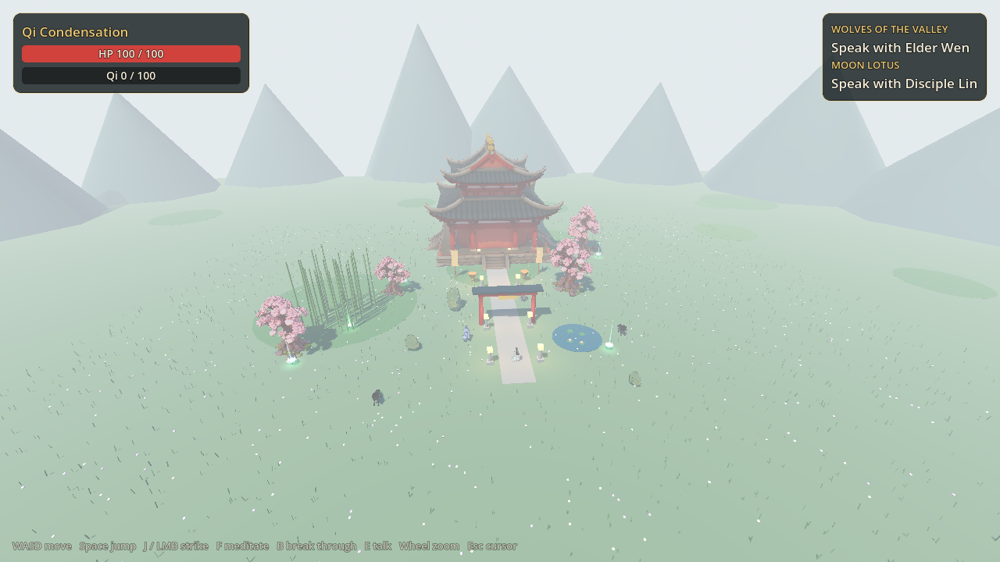

## Screenshots

| Third-person view at the sect gate | Sect hall |
| --- | --- |
| 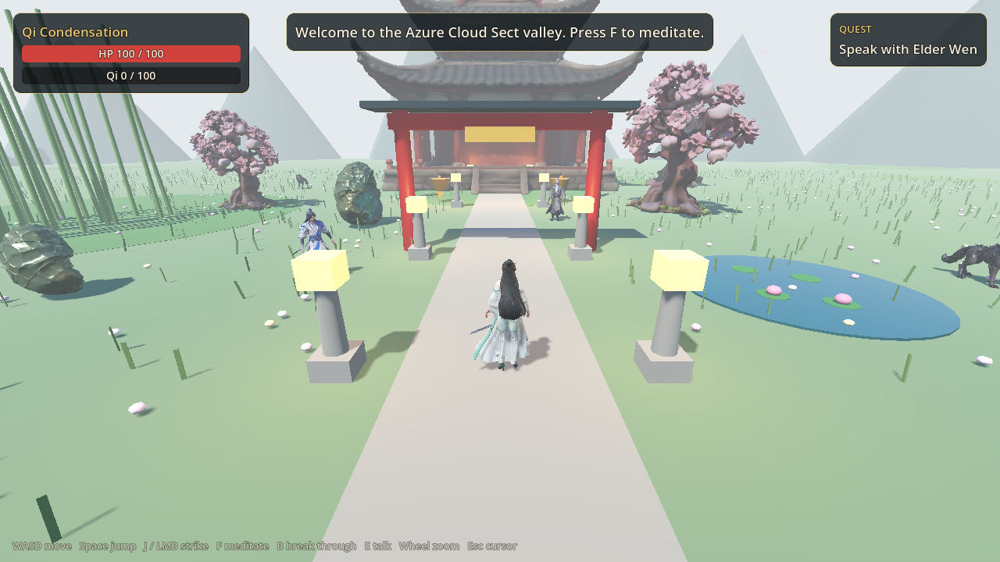 | 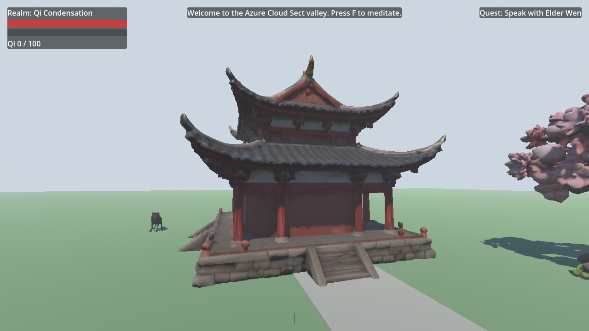 |

| Sect hall entrance |
| --- |
| 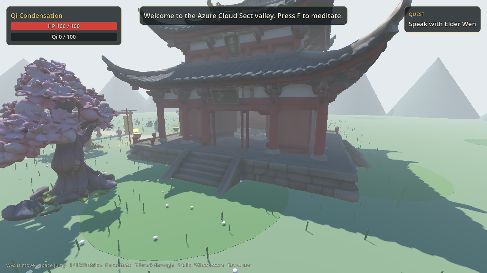 |

| Meditating and gathering qi |
| --- |
| 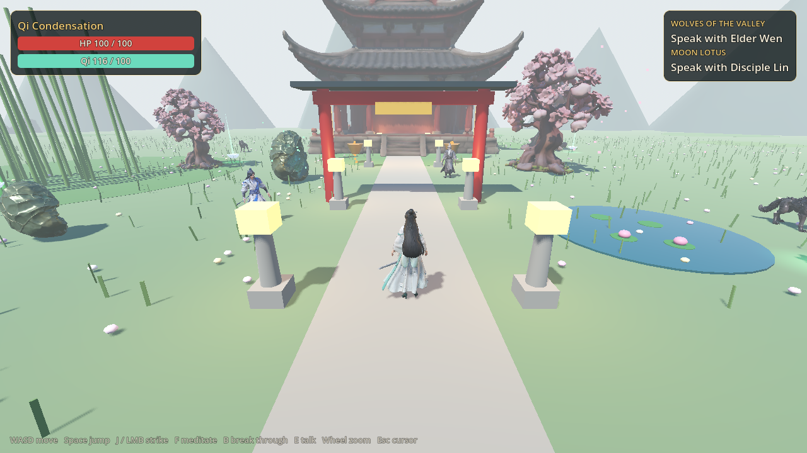 |

| Running | Sword strike |
| --- | --- |
| 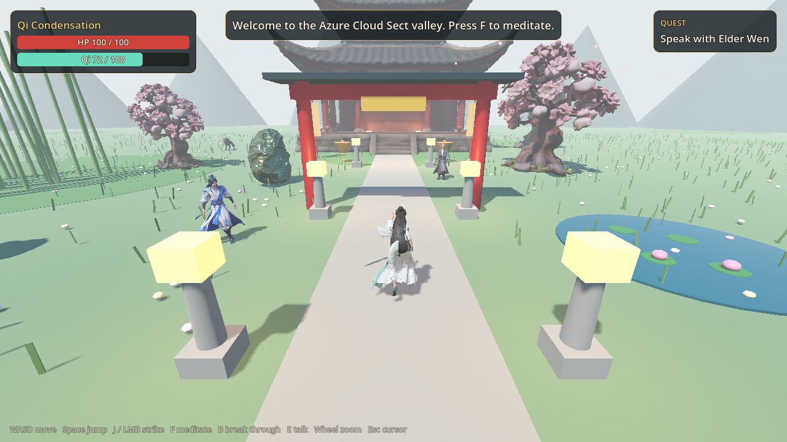 | 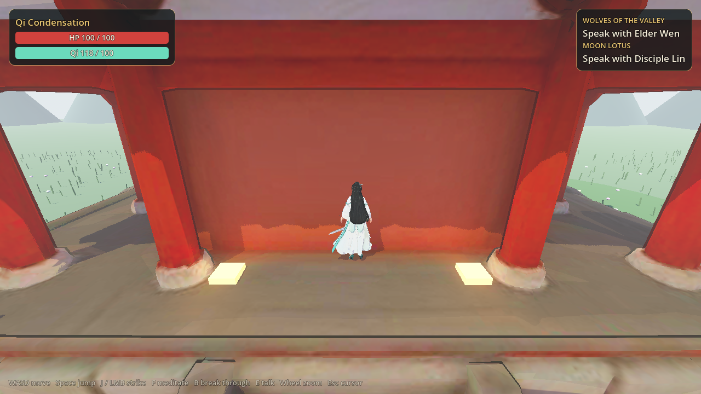 |

| A demon wolf charging the cultivator |
| --- |
| 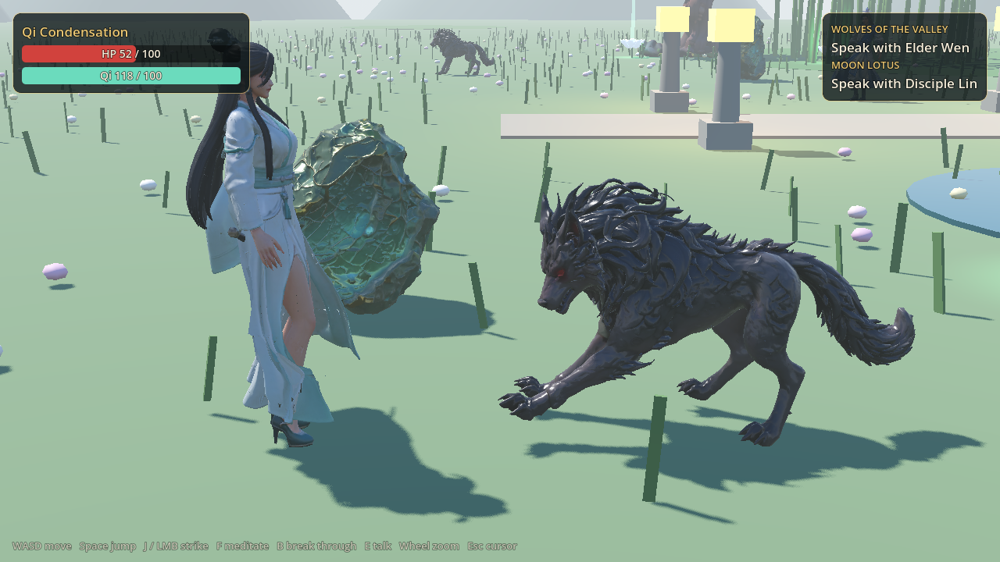 |

| Gathering a moon lotus for Disciple Lin | The Demon Wolf Alpha behind the hall |
| --- | --- |
| 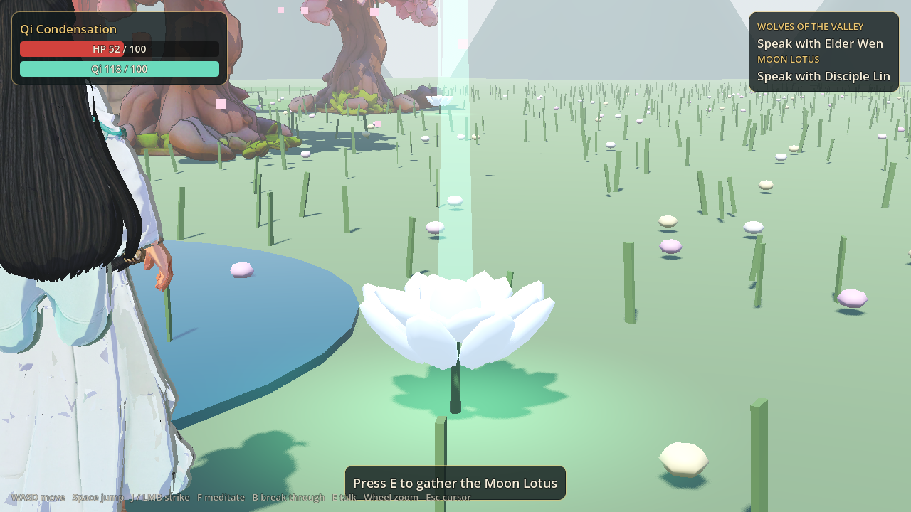 | 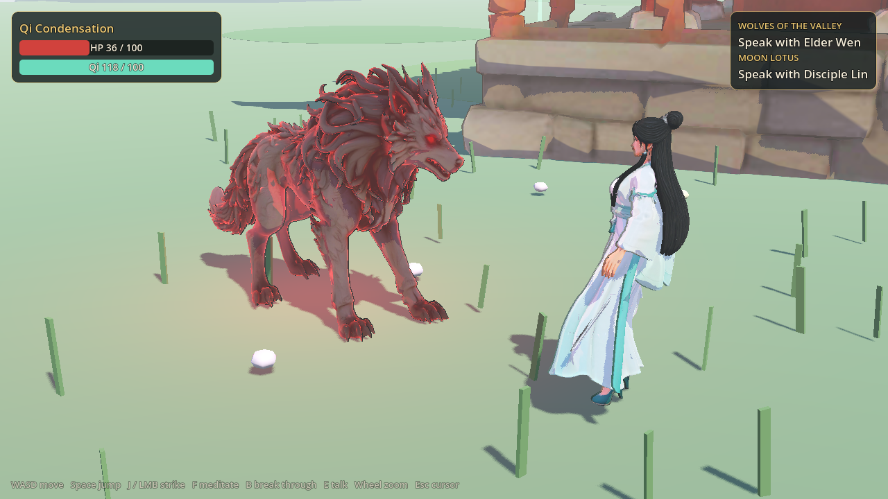 |

### Anime shading, before and after

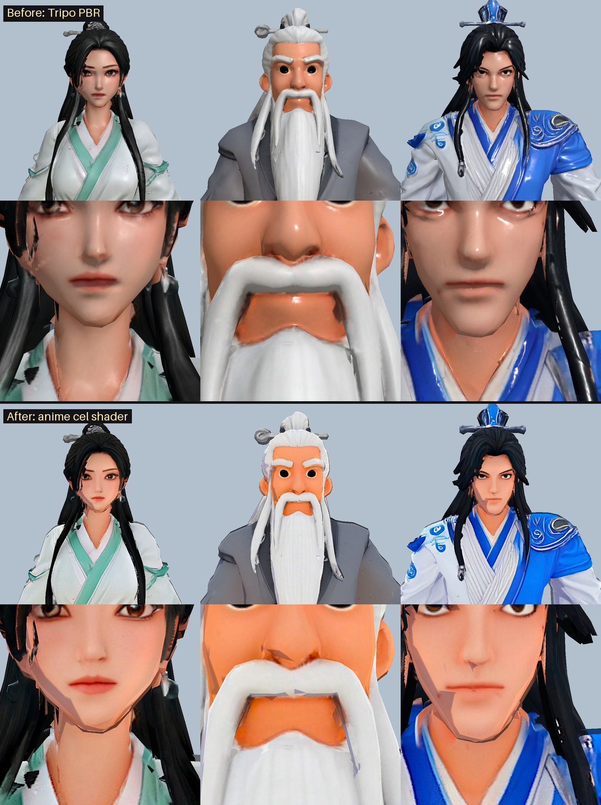

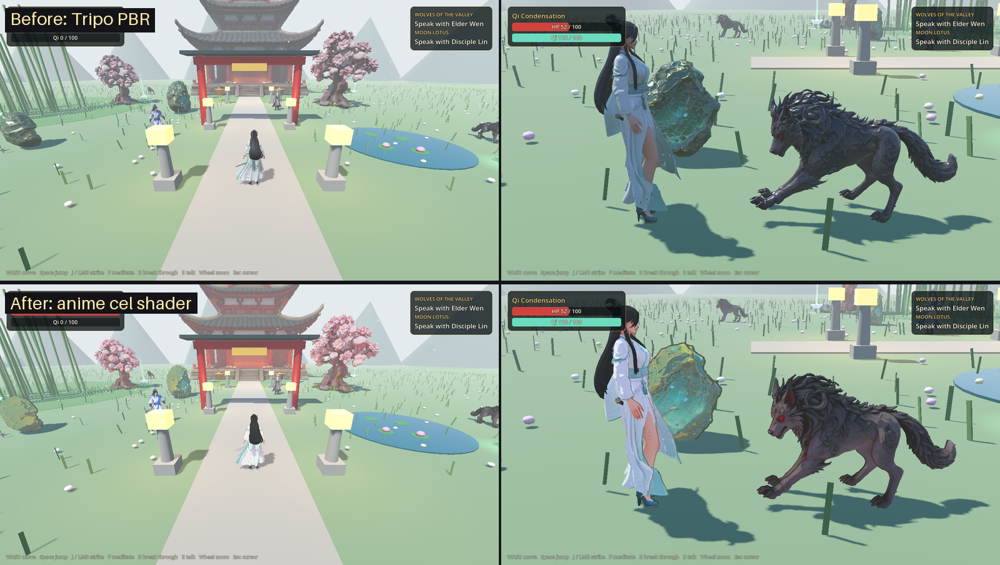

Top of each: Tripo's PBR materials, where specular gloss, a baked normal map and soft gradients made
skin and cloth look smudged, like an oil painting. Bottom: the cel shader, with two hard-edged tones
of light, no gloss, a sharpened and more saturated albedo, a rim light and ink outlines.
[Anime cel shading](docs/architecture.md#anime-cel-shading) explains how it works.


The first cut of the shader drew jagged shade wedges and hair-shadow blotches across faces. The
mesh normals were the cause, not the UVs: Tripo's decimated mesh has faceted normals, which
`tools/anime_normals.py` smooths, bending the head towards an ellipsoid. Characters also no longer
shadow themselves; one ray to the sun decides whether the whole character stands in shade. See
[Clean cel shadows](docs/architecture.md#clean-cel-shadows-normals-and-self-shadowing).

### Faces, before and after the texture bake

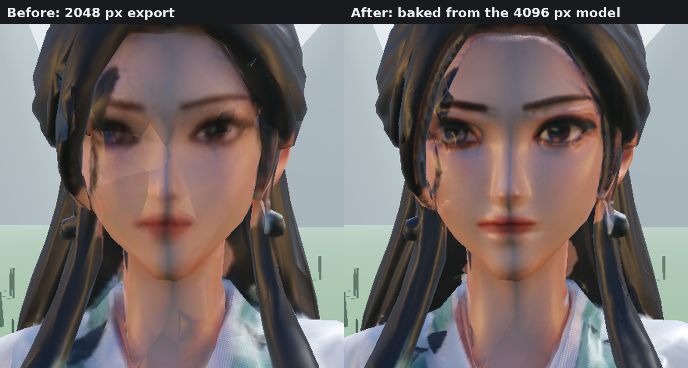

Left: the 2048 px export, where the face was a 100 px patch of the atlas. Right: baked from Tripo's
full model into a layout that gives the head nine times the area per unit of surface. The
[asset pipeline](docs/asset-pipeline.md#sharp-faces-bake-from-the-full-model) explains why the old
face was soft and how the bake works. The new shot is `player_face_closeup.png`, taken with a
camera closer than the game's zoom goes.

### Faces on the Compatibility renderer, before and after

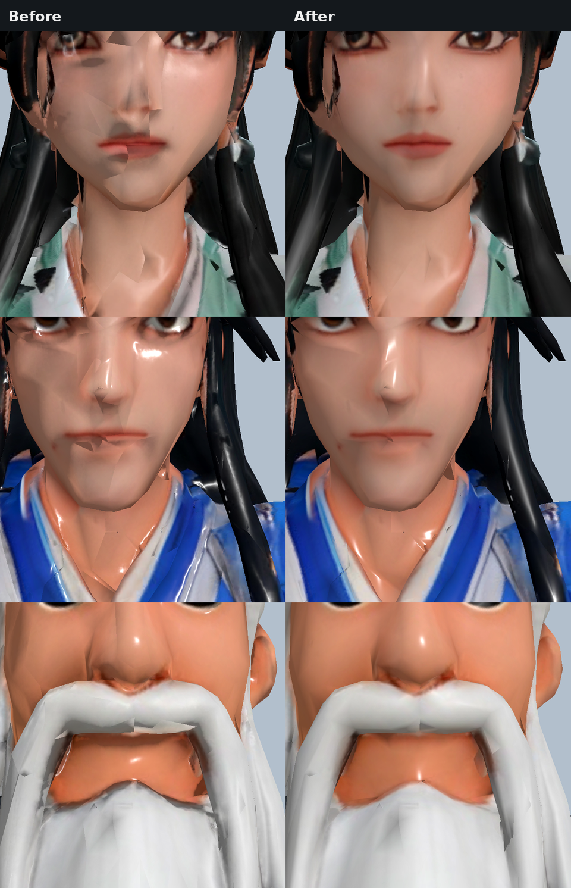

When Vulkan is missing, Godot falls back to its Compatibility renderer, whose skinning pass drops
the tangents of every skinned mesh. The characters' normal maps were then read in the wrong frame
and their faces broke into pale and dark patches (left). The game turned those normal maps off on
that renderer (right); the anime cel shader now leaves normal maps out on every renderer. See
[Model handling](docs/architecture.md#normal-maps-on-the-compatibility-renderer).

### Animation, before and after the rig repair

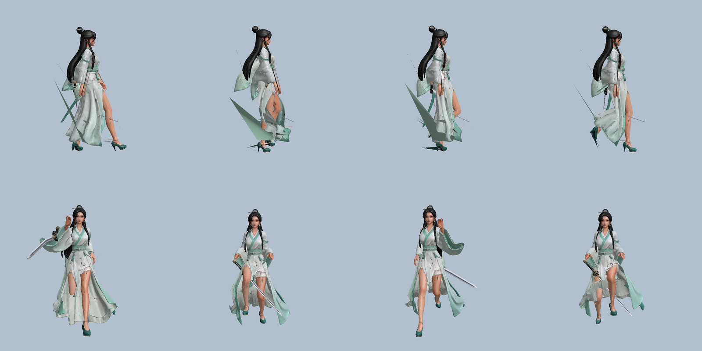

Top: Tripo's own `walk`, in profile and torn by its skin weights. Bottom: the repaired `run`. The
[asset pipeline](docs/asset-pipeline.md#rig-repair) explains what was wrong and how it was fixed.

## Features

- **Explore** the Azure Cloud Sect valley in third person, with a mouse-look camera and a
  scroll-wheel zoom.
- **Cultivate.** Meditate to gather qi and break through five realms. Each breakthrough costs
  twice the qi of the one before.
- **Fight** demon wolves with sword strikes that hit in a cone in front of you. The cut lands when
  the blade does, a quarter of a second after the key press. Wolves charge, flinch when hit and
  bite.
- **Quest.** Elder Wen sends you after two wolves and rewards you with qi when you return. Wolves
  slain before you accept the quest count towards it. Talk to him again and he sends you after
  the **Demon Wolf Alpha**, a larger wolf wreathed in red qi that waits behind the hall.
- **Gather herbs.** Disciple Lin at the gate asks for four moon lotuses. They glow by the pond, in
  the bamboo grove, under the spirit trees and behind the hall; press `E` beside one to gather it.
  Once you have brought them she shares her advice.
- **Keep hunting.** A slain wolf returns to its den 30 seconds later, once you are out of sight.
- **Enter the sect hall.** The hall is twice the height of the other buildings. Climb the stairs on
  its east side, walk along the entry gallery and drop into the cella. Its walls, pillars and
  stairs block you exactly where they are drawn.

## Controls

| Action | Keys |
| --- | --- |
| Move | `W` `A` `S` `D` or arrow keys |
| Look | Mouse (captured on start; `Esc` releases it, a click recaptures it) |
| Zoom camera | Mouse wheel |
| Jump | `Space` |
| Attack | `J` or left mouse button |
| Meditate (toggle) | `F` |
| Break through | `B` |
| Talk to an NPC, gather a lotus | `E` |

## Running the game

Requires Godot 4.7 or newer. The project is tested with 4.7.2.

```bash
godot --headless --path . --import   # first time: import the GLB models
godot --path .                       # launch the game
```

## Tests and lint

```bash
godot --headless --path . --import
godot --headless --path . --script res://tests/run_tests.gd   # 147 headless checks
pip install "gdtoolkit==4.5.0"
gdlint scripts tests tools
gdformat --check scripts tests tools
```

CI runs the same lint and test steps on every pull request. The workflow is in
`.github/workflows/ci.yml`.

## Generating assets with Tripo

`tools/generate_assets.sh` regenerates the models with the Tripo CLI, including the rigging and
animation steps. `tools/rebake_textures.py` then re-unwraps each model's UVs, which removes the
stretched texture islands Tripo's own unwrap produces. For the characters it also gives the head
nine times the texture area and bakes every map from Tripo's full-size 4096 px model in Blender
(`tools/bake_hires_maps.py`), so faces stay sharp when you zoom in. `tools/repair_character.sh NAME`
runs the whole character chain.
`tools/anime_normals.py` smooths the characters' normals for the cel shader.
`tools/tune_character_materials.py` sets the characters' material factors so they read as cloth and
skin rather than clay, and `tools/fix_character_rig.py` turns each character to face +Z, re-skins
its pinned vertices, smooths the weights that tear and replaces Tripo's preset clips with short
authored ones. `tools/carve_hall_doorway.py` opens the sect hall's east doorway. See
[docs/asset-pipeline.md](docs/asset-pipeline.md) for the prompts, credit costs, the rebake steps
and the texture bake.

## Project layout

```
assets/models/       Tripo GLB models (rigged, 4096 px character textures) and their Godot import sidecars
scenes/main.tscn     root scene; builds the valley from code
shaders/             anime cel shader and ink outline for the Tripo models
scripts/core/        cultivation rules, quest rules, animation driver, model fitting, input
scripts/player/      the cultivator (player)
scripts/enemies/     spirit beast enemy AI
scripts/npc/         NPC interaction base
scripts/world/       procedural valley decoration, moon lotuses
scripts/ui/          HUD
tests/               headless test runner
tools/               asset generation, UV rebake and screenshot capture scripts
docs/                architecture, asset pipeline, screenshots
```

## Documentation

- [Architecture](docs/architecture.md): scene tree, systems, quest line, quest and animation state
  diagrams, combat sequence, the anime cel shader and the Compatibility renderer fix.
- [Asset pipeline](docs/asset-pipeline.md): Tripo workflow, rigging, asset table and previews.

## License

See [LICENSE](LICENSE).
