# Architecture

Xianxia Ascension is a Godot 4.7 project written in GDScript. Every gameplay object is built from
code at runtime, so the only hand-authored scene is `scenes/main.tscn`, which attaches
`scripts/main.gd` to the root. The Tripo models are loaded through `preload()`.

## Scene tree

Built by `scripts/main.gd` when the scene enters the tree.

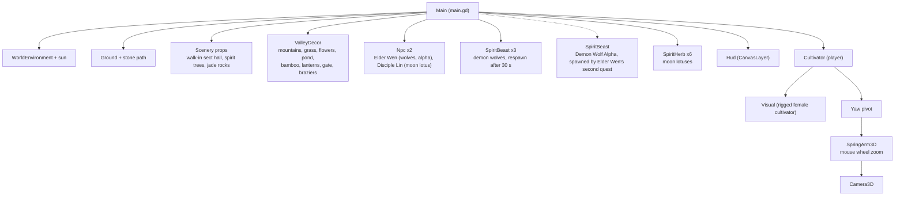

## Systems and their relationships

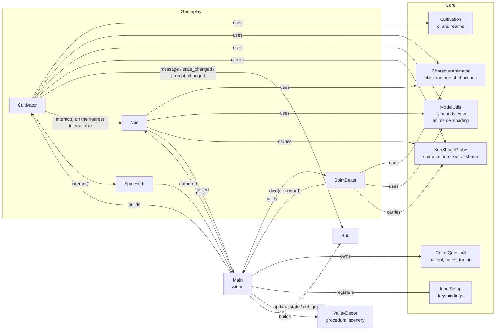

## Class overview

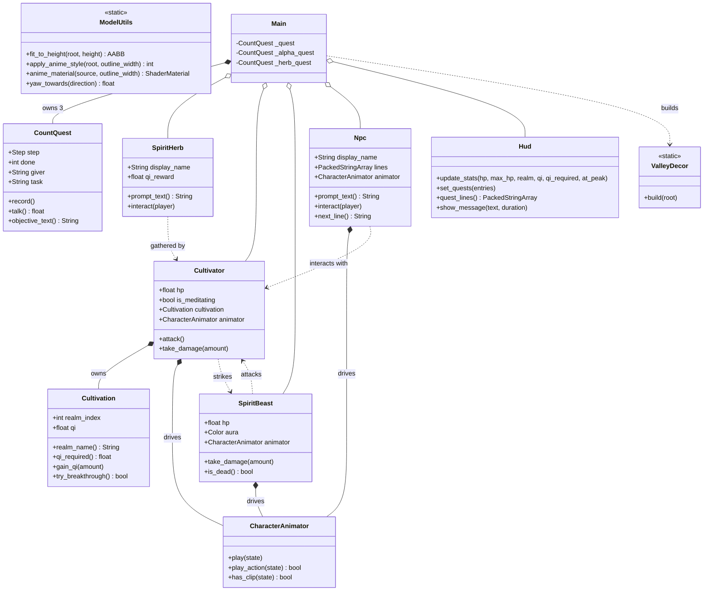

## Quests

Each quest is a `CountQuest`: pure rules for accepting, counting and turning in, with the giver's
name and the task in its objective. `Main` owns three and shows the dialogue. Everything counts,
including what was done before the quest was accepted, and talking to the giver accepts the quest
and turns it in on the same visit when the count is already met.

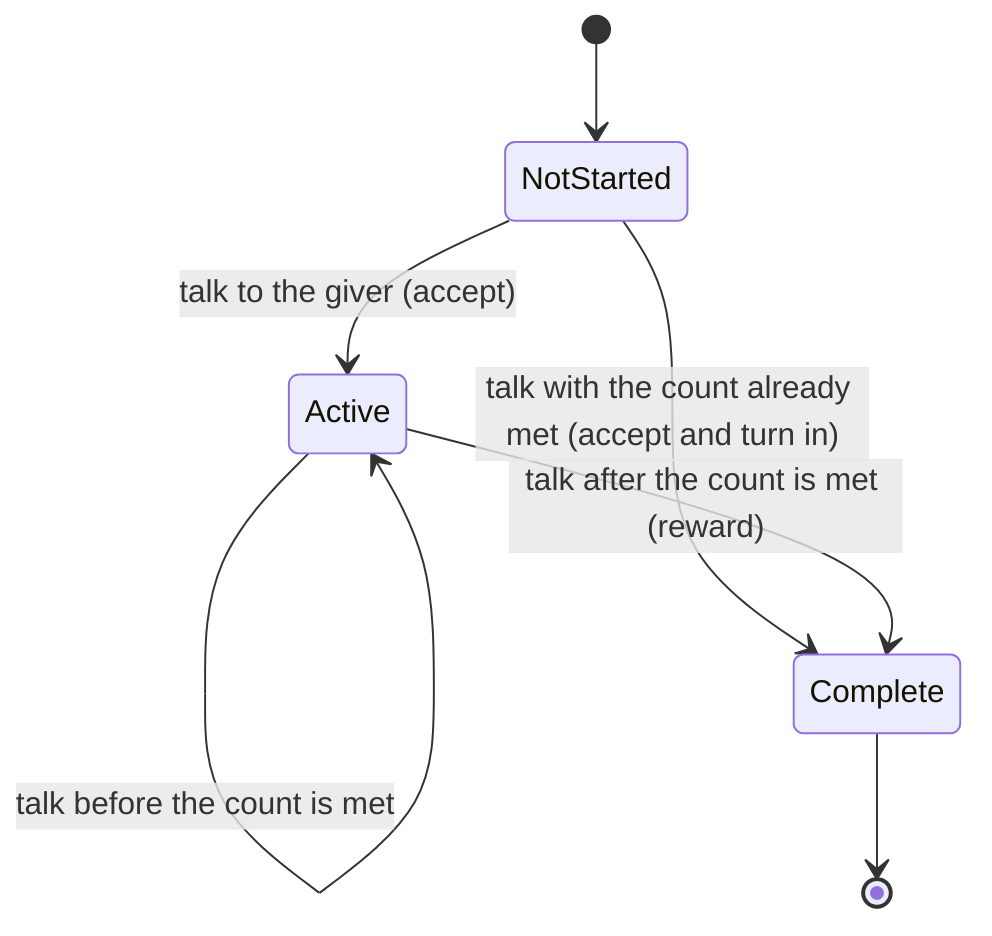

The three quests and what they pay:

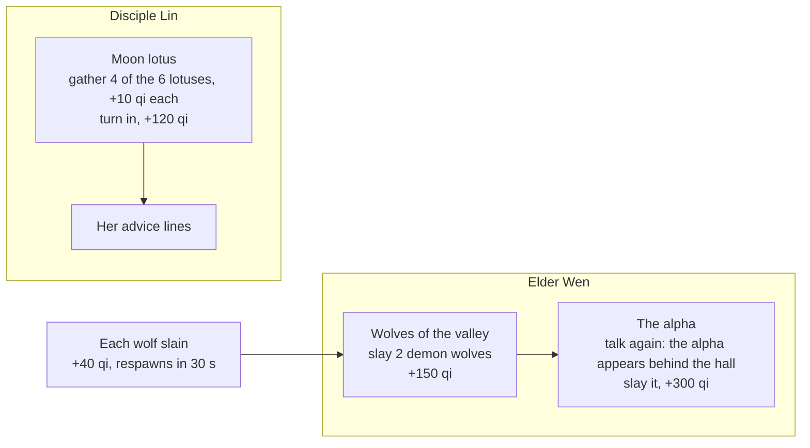

The HUD lists Elder Wen's current hunt above Lin's lotus quest. A slain wolf of the pack returns to
its den 30 s later, once the cultivator is at least 14 m away, so there is always qi to hunt for.
The alpha is a `SpiritBeast` half as tall again as a wolf, with 220 health, a 16 damage bite and a
red rim of qi drawn by an additive overlay shader; it does not respawn.

Moon lotuses glow and carry a faint beam of qi so they can be found from across the valley. The
cultivator's interact key talks to an NPC or gathers a lotus: both join the `interactables` group
and share `prompt_text()` and `interact()`, and the nearest one within 3 m wins.

## Animation states

`CharacterAnimator` plays the clips baked into each repaired Tripo character
(`tools/fix_character_rig.py`). Looping states cross-fade over 0.2 s and keep playing until the state
changes. One-shot actions snap in over 0.06 s, play once and then return to the looping state. A
missing clip falls back to a procedural effect or to the nearest clip.

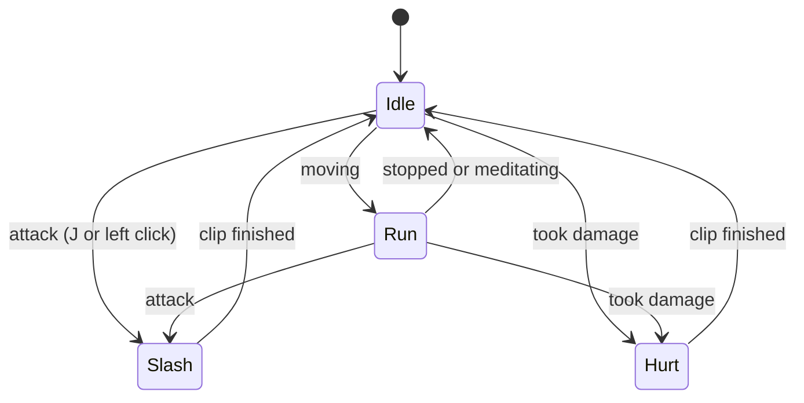

Every humanoid has idle, walk, run, slash, hurt and greet. The wolf has idle, walk, run, slash (a
bite) and hurt. The player runs whenever it moves, the beast runs while it chases, and Elder Wen
and Disciple Lin play greet when talked to. No model needs the procedural fallbacks any more.

## Cultivation progression

Breaking through costs the realm's qi requirement, which doubles with every realm. The final
realm has no further breakthrough.

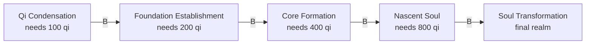

## Combat and meditation

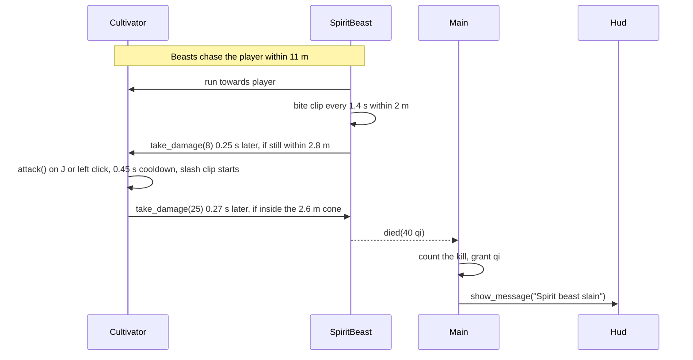

Meditation (`F`) is a toggle. While it is active the cultivator gains 12 qi per second and
regenerates health. Moving cancels it, and so does taking a hit.

## Input

| Action | Keys |
| --- | --- |
| Move | `W A S D` or arrow keys |
| Look | Mouse (captured on start, `Esc` releases) |
| Zoom | Mouse wheel (clamped between 1.8 m and 9 m) |
| Jump | `Space` |
| Attack | `J` or left mouse button |
| Meditate | `F` |
| Break through | `B` |
| Talk | `E` |

Bindings are registered in code by `InputSetup` so they stay readable and need no hand-edited
`project.godot` entries.

## Model handling

Tripo exports vary in scale and origin. `ModelUtils.fit_to_height` measures the union of the
model's mesh bounds, scales it uniformly to the requested height, and sits it on the ground.
Solid props use the same measured bounds for a box collider.

Every character model faces +Z, the glTF front, because `tools/fix_character_rig.py` turns them
that way in the file. The game therefore needs no per-model correction: a character's visual is
rotated by the yaw of its heading and nothing else (`ModelUtils.FORWARD_OFFSET` is `0`). Tripo's own
humanoids faced +X and its wolf +Z, which is why they once walked sideways or backwards.

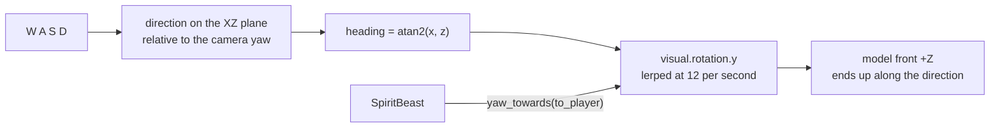

### Anime cel shading

Tripo bakes its textures for physically based shading. Lit that way, with a normal map full of
baked wrinkles and a specular highlight on every surface, skin and cloth looked glossy and smudged,
like an oil painting. `ModelUtils.apply_anime_style` replaces each model's material with a cel
shader (`shaders/anime_toon.gdshader`) when the model is placed, and gives it an ink outline as a
second pass (`shaders/anime_outline.gdshader`). Characters, wolves and the Tripo scenery all get
it; the scenery's outline is wider because it is seen from further away.

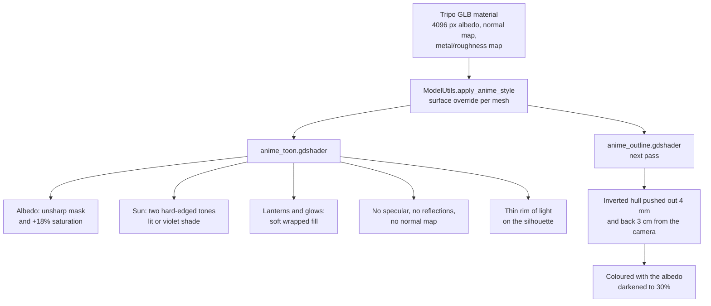

- **Two tones.** `light()` turns the sun's N.L into lit or shade with an edge 0.05 wide, so
  shading is a clean shape instead of a gradient. Scenery snaps its cast shadows to the same shade;
  characters take one shade for the whole body (see below). The shade is a cool violet multiplied
  into the colour, as anime colourists paint it. Lanterns and glows add soft wrapped light.
- **Sharper colour.** Tripo's baked albedo is soft. The shader subtracts a four-tap blur 1.5 texels
  wide from it (an unsharp mask) and raises the saturation, so lines and colour boundaries in the
  texture come out crisp.
- **No gloss.** Specular, reflections and roughness are off, and the normal map is not used: cel
  shading wants the smooth vertex normals.
- **Ink lines.** The outline is an inverted hull, pushed out along the view-space normal by a width
  in metres, so it thins with distance. It is also pushed 3 cm away from the camera, so it draws
  around the silhouette but not through the layered collars, sleeves and hair in front of it.

### Clean cel shadows: normals and self-shadowing

The first cut of the cel shader cut jagged wedges and blotches across faces. Rendering the face
with the shading split into its parts showed two causes, and ruled out the UVs: a UV checker
shows fragmented charts, but the shade shapes do not follow them, because lighting never reads UVs.

- **Mesh normals.** Tripo's decimated mesh has noisy, faceted normals: on the cultivator 43% of
  edges turned more than 32 degrees from one end to the other. The two-tone edge sits where N.L
  crosses a threshold, so it zigzagged along triangle edges. `tools/anime_normals.py` welds the
  vertices that UV seams split, rebuilds area-weighted smooth normals, relaxes them over their
  neighbours, and bends the head's normals 60% of the way towards an ellipsoid fitted around it,
  the usual anime trick, so a face shades as one shape. Only the NORMAL bytes of the GLBs change.
  The share of sharp edges drops to 12 to 22%, and the tests hold it under 25%.
- **Self-shadowing.** Thin hair strands and sleeves cast ragged blotches through the shadow map,
  which two-tone shading turned into hard black shapes. Characters no longer take the shadow map
  (`self_shadows` off). A `SunShadeProbe` on each character casts one ray from the chest towards
  the sun every physics frame; if the hall, a tree or a rock is in the way, the whole character
  fades into its shade tone over a quarter of a second. Other characters do not count. Scenery
  keeps its shadow map, and characters still cast shadows onto it.
- **Lanterns.** At the sect gate a dark stripe ran down the middle of the cultivator's face. Hiding
  the 16 omni lights alone removed it: the two gate lanterns each light one cheek, and the hard
  cel terminator left the front of the face, which neither reaches, unlit. Point lights now give
  soft wrapped (half-Lambert) fill with their smooth falloff; only the sun is drawn in two tones.

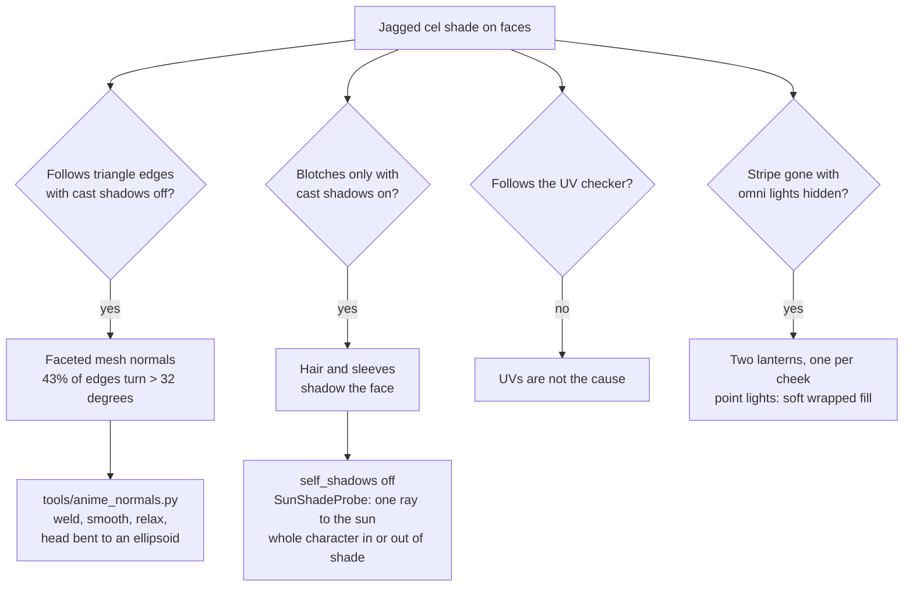

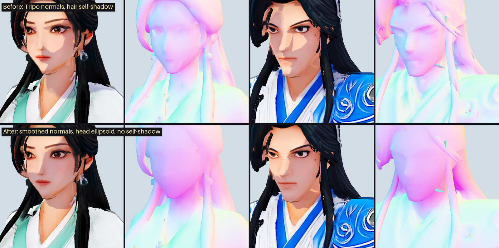

Columns: the cultivator and Disciple Lin, each lit and then with normals drawn as colour. Top:
Tripo's normals with the shadow map. Bottom: the rewritten normals without self-shadowing.

### Normal maps on the Compatibility renderer

The game runs on Forward+, and Godot falls back to the Compatibility renderer (OpenGL 3) when
Vulkan is missing. That renderer skins meshes in a transform-feedback pass that never binds the
`TANGENT` attribute (`drivers/gles3/storage/mesh_storage.cpp` in 4.7.2), so every vertex of a
skinned mesh comes out with the same tangent. A tangent-space normal map is then read in the wrong
frame, and on the characters, whose UV charts all have their own tangent frames, faces broke into
pale and dark patches. The game used to turn the normal maps of skinned meshes off on that renderer
only. The cel shader above does not read normal maps on any renderer, so the problem is gone
everywhere and the workaround was removed.

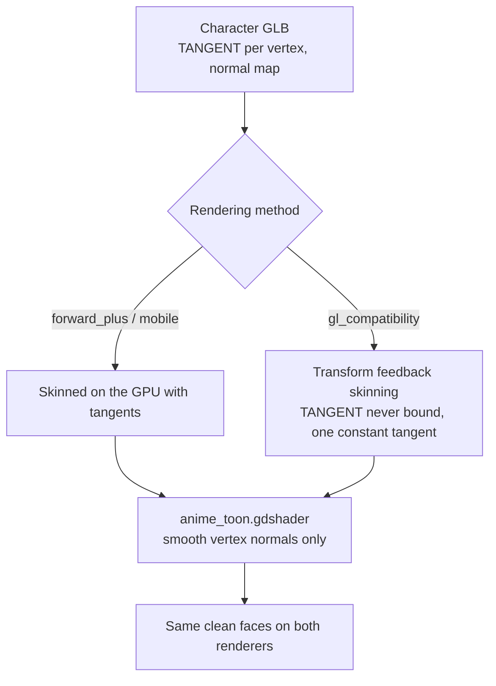

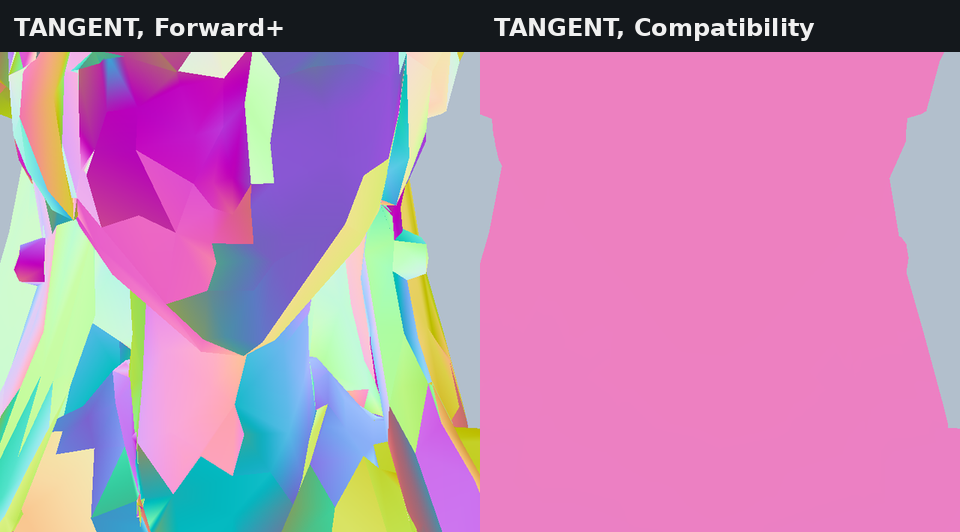

Left: `TANGENT` drawn as a colour on Forward+, one frame per UV chart as the file stores them.
Right: the same on Compatibility, one colour everywhere.

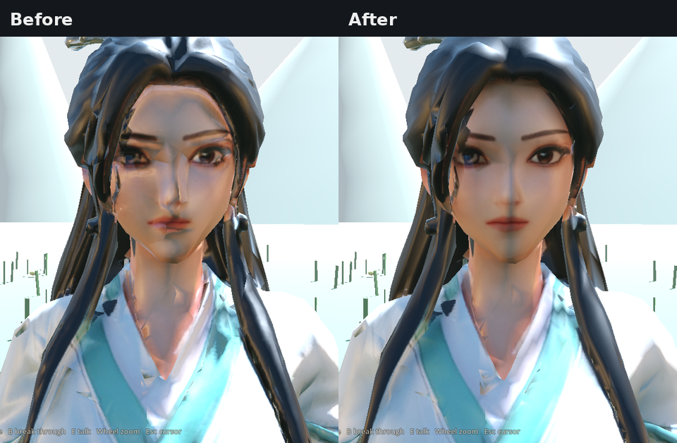

The cultivator in the valley on the Compatibility renderer, before and after the original fix.

GLB textures are embedded in the GLB. Godot's import setting `gltf/embedded_image_handling=2`
compresses them into the imported scene, so no texture files are extracted next to the models.

## Sect hall walk-in

The hall's collision is its own mesh, so nothing sits outside the building or inside it. The
stairs are the one exception: a capsule cannot climb their risers, so they are removed from the mesh
and replaced by ramps. Each ramp is a slab that runs from the ground to the terrace it serves.

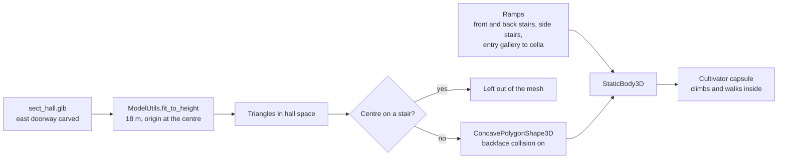

The route from outside to the cella, and the heights along it, are fixed by the model:

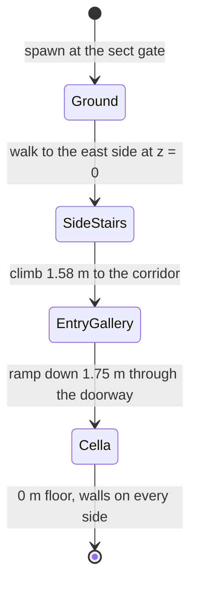

## Testing and CI

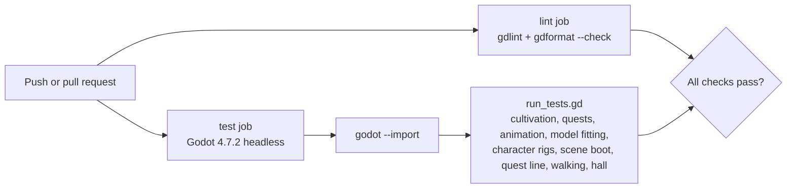

The character rig checks load each character GLB and check its clip names and lengths, that it
faces +Z, that no vertex is pinned to the dummy `neutral_bone`, and that no triangle stretches past
6x in any of three poses of every clip. That last check skins the mesh on the CPU, so it catches
the spikes and smeared textures that broken skin weights cause, which a screenshot would only show
by eye. A walking check holds each movement key in turn and asserts that the cultivator ends up
facing the way it moves. A quest-line check plays both quest givers through in the real scene:
it gathers four lotuses and turns them in to Lin, slays two wolves for Elder Wen, takes the alpha
quest, slays the alpha and checks the qi paid and the tracker at every step.

Run the suite locally with:

```bash
godot --headless --path . --import
godot --headless --path . --script res://tests/run_tests.gd
```
