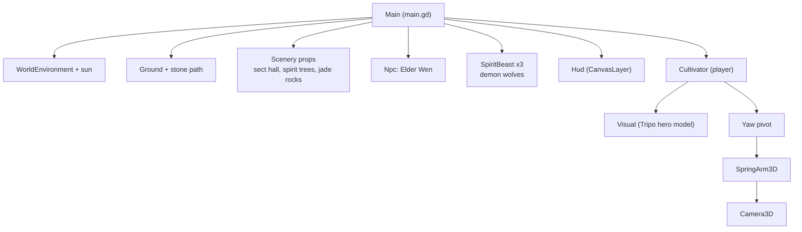
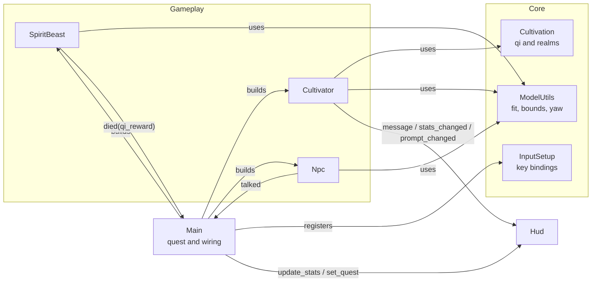
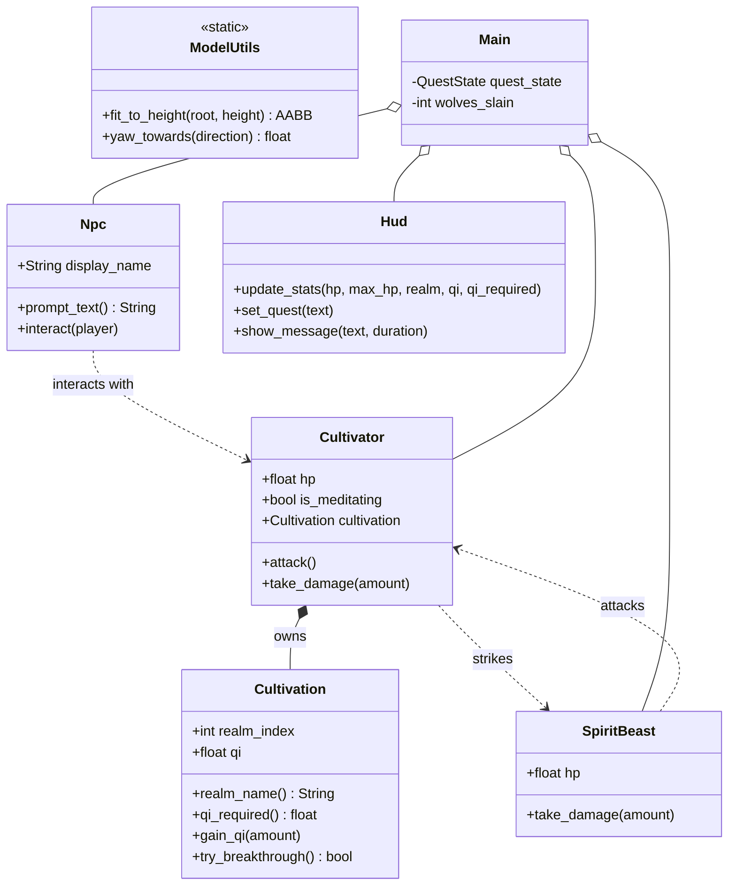
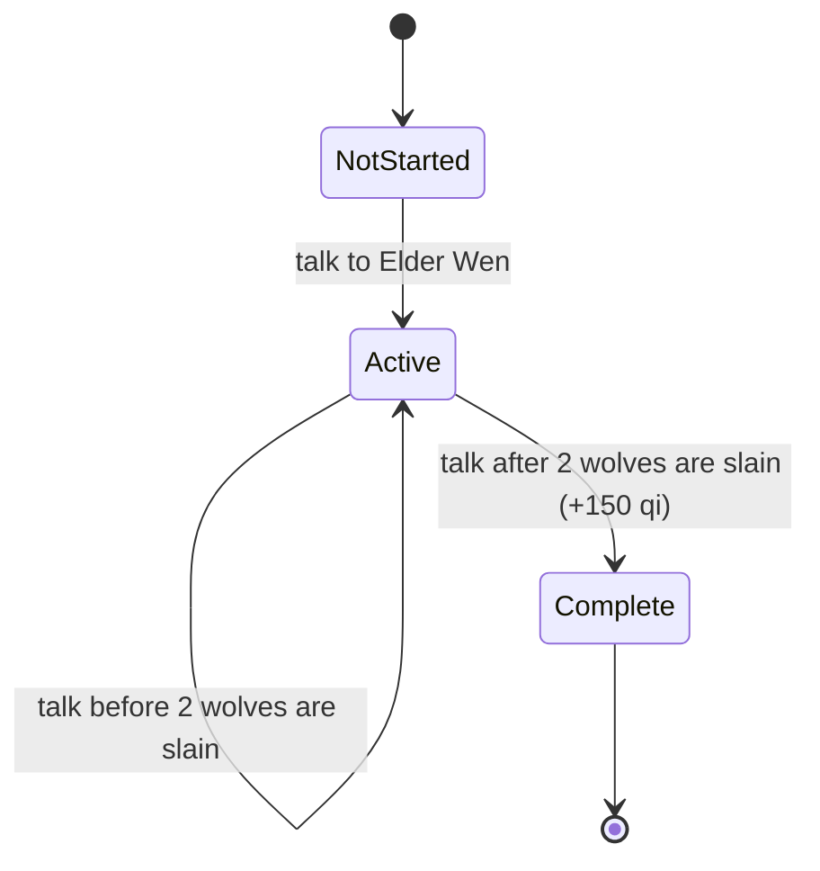
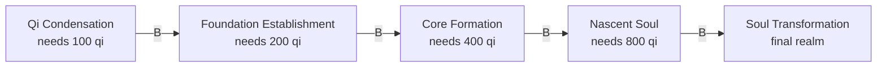
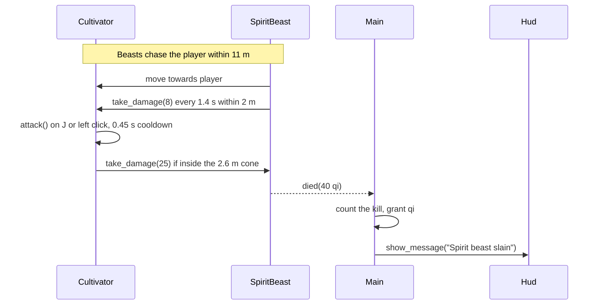
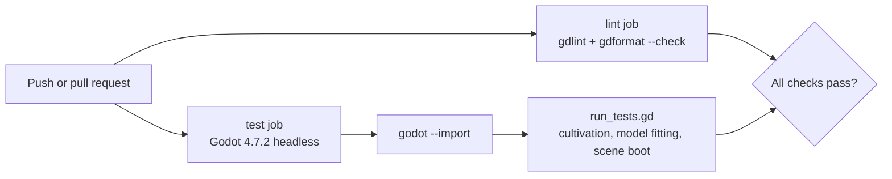

# Architecture

Xianxia Ascension is a Godot 4.7 project written in GDScript. Every gameplay object is built from
code at runtime, so the only hand-authored scene is `scenes/main.tscn`, which attaches
`scripts/main.gd` to the root. The Tripo models are loaded through `preload()`.

## Scene tree

Built by `scripts/main.gd` when the scene enters the tree.



## Systems and their relationships



## Class overview



## Quest state

`Main` owns the quest. Killing wolves is tracked on every kill, and the reward is paid when the
player reports back to Elder Wen.



## Cultivation progression

Breaking through costs the realm's qi requirement, which doubles with every realm. The final
realm has no further breakthrough.



## Combat and meditation



Meditation (`F`) is a toggle. While it is active the cultivator gains 12 qi per second and
regenerates health. Moving cancels it.

## Input

| Action | Keys |
| --- | --- |
| Move | `W A S D` or arrow keys |
| Look | Mouse (captured on start, `Esc` releases) |
| Jump | `Space` |
| Attack | `J` or left mouse button |
| Meditate | `F` |
| Break through | `B` |
| Talk | `E` |

Bindings are registered in code by `InputSetup` so they stay readable and need no hand-edited
`project.godot` entries.

## Model handling

Tripo exports vary in scale and origin. `ModelUtils.fit_to_height` measures the union of the
model's mesh bounds, scales it uniformly to the requested height, and sits it on the ground.
Solid props use the same measured bounds for a box collider. Visual front faces are aligned
with `ModelUtils.FORWARD_OFFSET`.

## Testing and CI



Run the suite locally with:

```bash
godot --headless --path . --import
godot --headless --path . --script res://tests/run_tests.gd
```
