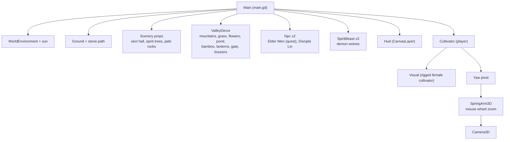
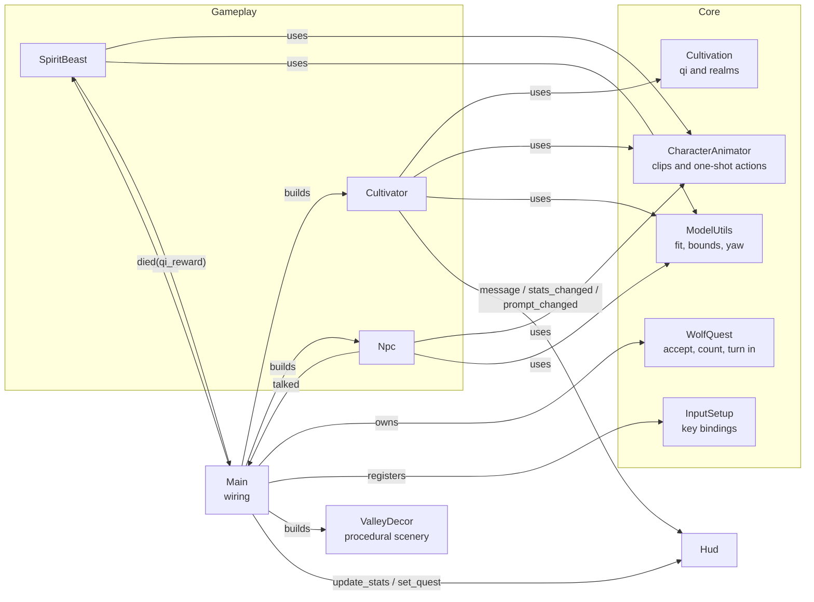
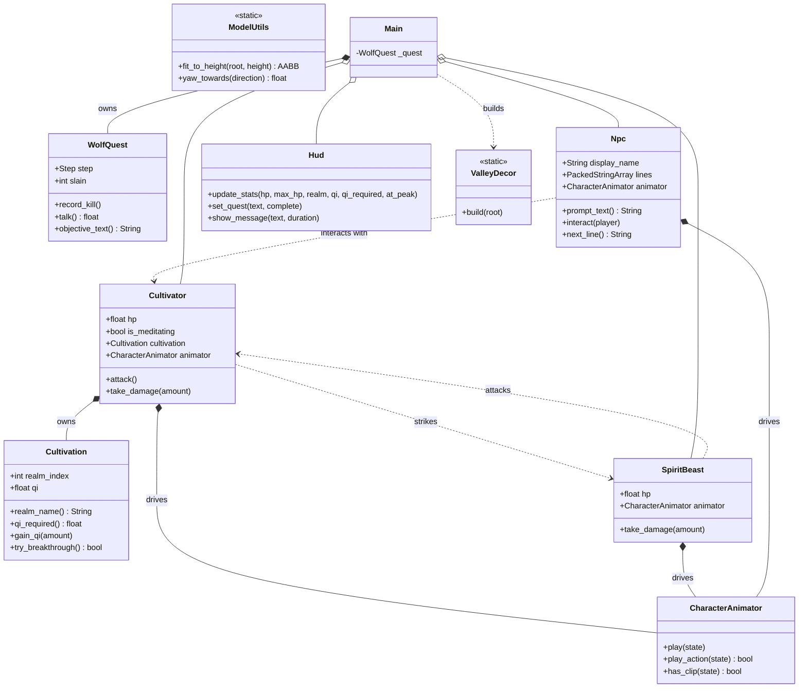
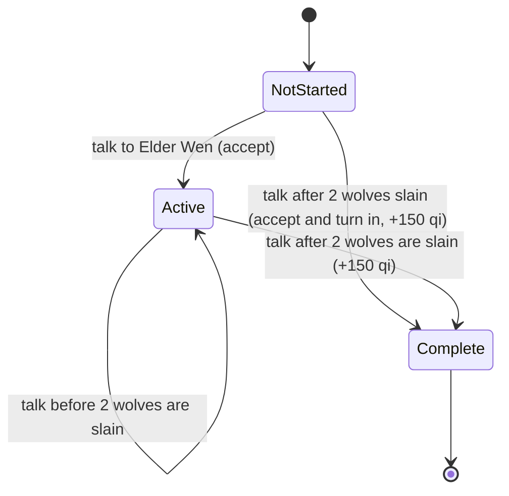
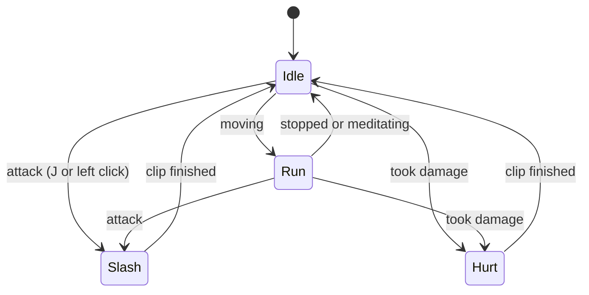
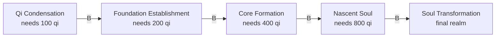
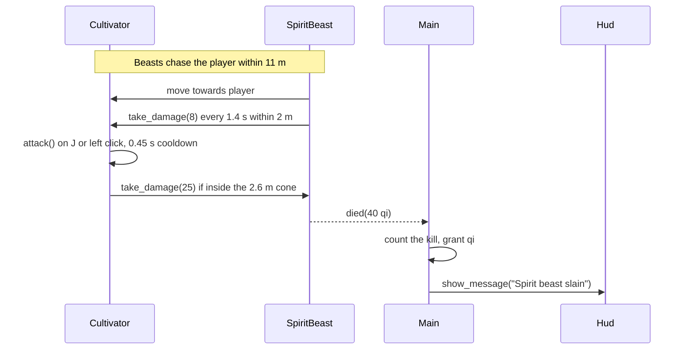
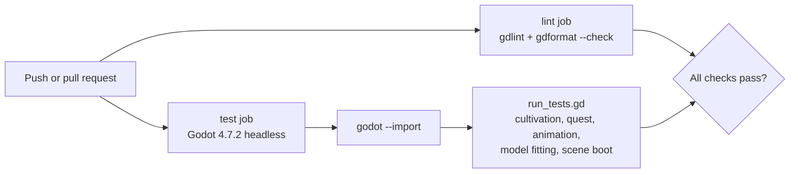

# Architecture

Xianxia Ascension is a Godot 4.7 project written in GDScript. Every gameplay object is built from
code at runtime, so the only hand-authored scene is `scenes/main.tscn`, which attaches
`scripts/main.gd` to the root. The Tripo models are loaded through `preload()`.

## Scene tree

Built by `scripts/main.gd` when the scene enters the tree.



## Systems and their relationships



## Class overview



## Quest state

`WolfQuest` holds the rules, and `Main` shows the dialogue. Every wolf slain is counted, including
wolves killed before the quest was accepted. Talking to Elder Wen accepts the quest and turns it in
on the same visit when enough wolves are already slain.



## Animation states

`CharacterAnimator` plays the preset clips baked into each rigged Tripo model. Looping states keep
playing until the state changes. One-shot actions play once and then return to the looping state.
A missing clip falls back to a procedural effect or to the nearest clip.



Each model has its own set of clips. The female cultivator has idle, walk, run, slash and hurt.
The elder has idle, walk and greet. The wolf has only walk, so it holds the first frame of that
cycle while idle and flinches or lunges procedurally when hit or striking.

## Cultivation progression

Breaking through costs the realm's qi requirement, which doubles with every realm. The final
realm has no further breakthrough.



## Combat and meditation



Meditation (`F`) is a toggle. While it is active the cultivator gains 12 qi per second and
regenerates health. Moving cancels it, and so does taking a hit.

## Input

| Action | Keys |
| --- | --- |
| Move | `W A S D` or arrow keys |
| Look | Mouse (captured on start, `Esc` releases) |
| Zoom | Mouse wheel (clamped between 1.8 m and 9 m) |
| Jump | `Space` |
| Attack | `J` or left mouse button |
| Meditate | `F` |
| Break through | `B` |
| Talk | `E` |

Bindings are registered in code by `InputSetup` so they stay readable and need no hand-edited
`project.godot` entries.

## Model handling

Tripo exports vary in scale and origin. `ModelUtils.fit_to_height` measures the union of the
model's mesh bounds, scales it uniformly to the requested height, and sits it on the ground.
Solid props use the same measured bounds for a box collider. Visual front faces are aligned
with `ModelUtils.FORWARD_OFFSET`.

GLB textures are embedded in the GLB. Godot's import setting `gltf/embedded_image_handling=2`
compresses them into the imported scene, so no texture files are extracted next to the models.

## Testing and CI



Run the suite locally with:

```bash
godot --headless --path . --import
godot --headless --path . --script res://tests/run_tests.gd
```
