# Tripo asset pipeline

Every 3D model in `assets/models/` was generated with the Tripo CLI from a text prompt. The
full-size GLBs that Tripo returns are about 45 MB each because of their 1.4 million triangles and
4096 px textures, so each one is re-exported with at most 30,000 faces before it is committed.
The props use the 2048 px export. The characters do not: their textures are baked again from the
full-size model so that faces stay sharp up close (see [Sharp faces](#sharp-faces-bake-from-the-full-model)).
The characters are also rigged. Tripo's rigs and preset clips are not usable as they come, so a
repair step fixes their facing, skin weights and animation (see [Rig repair](#rig-repair)).

## Flow

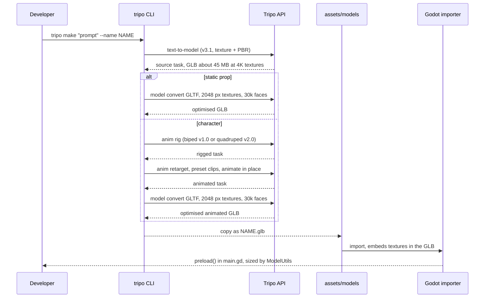

## After Tripo: the order of the repair steps

Each Tripo GLB goes through up to four offline steps before it is committed. They all read and
write plain GLBs and need no account.

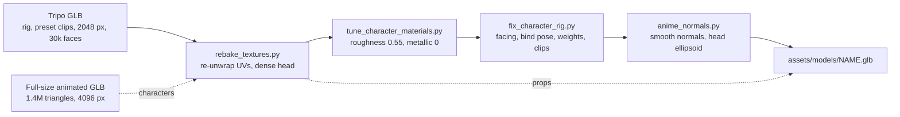

Props only need the rebake, and it moves their 2048 px maps into the new layout. Characters need all
four, in this order, and are baked from the full-size model. The rig repair refuses to run twice
on the same file. The normal rewrite only touches the NORMAL bytes; a second run smooths a little further, so run it once; see
[Clean cel shadows](architecture.md#clean-cel-shadows-normals-and-self-shadowing).
`tools/repair_character.sh NAME` runs the four steps for one character.

## Regenerating

`tools/generate_assets.sh` holds the exact prompts, rig types, animation presets and commands. It
needs the CLI and a logged-in account. It keeps both the 2048 px export and the full-size animated
GLB of every character in `.tripo-work/`, because the repair bakes from the second:

```bash
npm install -g tripo-cli
tripo login
tools/generate_assets.sh                 # every asset
tools/generate_assets.sh female_cultivator   # one asset
DRY_RUN=1 tools/generate_assets.sh       # validate prompts, spends no credits
tools/repair_character.sh female_cultivator   # rebake, tune and rig repair, writes assets/models/
```

Approximate credit costs from the runs that produced the committed models:

| Step | Credits |
| --- | --- |
| Text-to-model, standard texture | 20 |
| Text-to-model, `texture_quality=detailed` | 30 |
| Convert to GLTF at 2048 px | 10 |
| Rig (`anim rig`) | 25 |
| Each preset animation (`anim retarget`) | 10 |

## UV re-unwrap and texture transfer

Tripo's own unwrap splits clothing and skin into hundreds of small, stretched islands. About 15%
of triangles are stretched more than 3:1, and the 512 px normal map shows up as grain when the
camera gets close. `tools/rebake_textures.py` fixes this for each model:

1. Unwraps the mesh with xatlas, which minimises stretch and pads charts by 4 px.
2. Transfers the base colour, normal and metal/roughness maps from the old UVs to the new ones.
   Each triangle keeps its index, so the old UV of any new texel is the barycentric blend of that
   triangle's old corner UVs.
3. Converts normals through the old and new tangent frames, then blurs them with a 2 px radius at
   1024 px. The blur removes the baked grain and keeps the broad folds.
4. Writes the GLB with new vertex buffers and images. Skins, animations and the material are
   carried over unchanged.

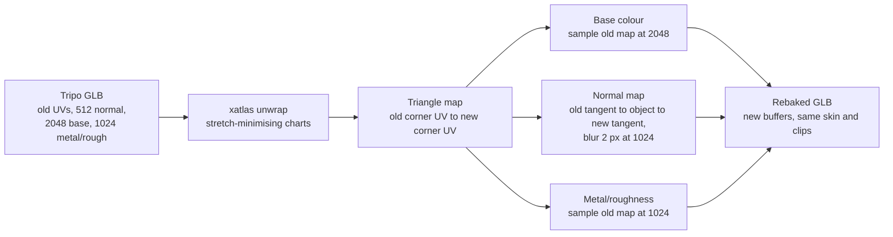

```bash
pip install xatlas numpy pillow
tools/rebake_textures.py assets/models/hero.glb .tripo-work/hero.glb
```

Measured on the hero model (the other characters and props show the same pattern):

| Metric | Tripo UV | Rebaked |
| --- | --- | --- |
| Triangles stretched more than 3:1 | 14.2% | 1.3% |
| 90th percentile stretch | 3.75 | 1.18 |
| Texel density, 5th to 95th percentile (relative to median) | 0.60 to 1.64 | 0.95 to 1.17 |
| Normal map | 512 px | 1024 px, blurred |

The rebaked GLBs are 1.4 to 1.6 times the size of the Tripo originals, 36 MB in total instead of
24 MB. Around 1,000 tiny triangles per
character snap to a single texel during packing. They are too small to see, but they are a known
limitation.

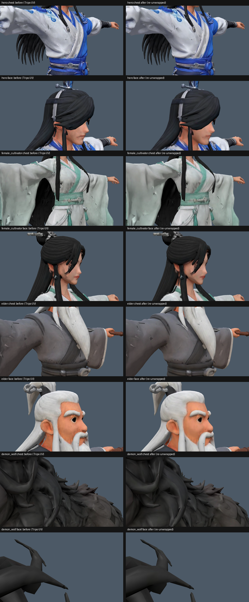

Before (top) is each model's Tripo UV layout. After (bottom) is the re-unwrapped layout with the
transferred textures. Each pair is the same camera position.

## Sharp faces: bake from the full model

Zoomed in on the cultivator, her face was soft and blotchy: the eyes were smears, the lips had no
edge and pale polygons floated over the cheeks. The cause was not the game or the face itself.
Tripo's full-size model has a good face, around 400 px wide in its 4096 px texture. It was lost
in three steps on the way to the repo.

| Step | What it did to the face |
| --- | --- |
| Tripo's atlas | Spreads 4096 px evenly over the whole body, hair included. The head is 5 to 7% of the surface, so the face gets a patch about 400 px wide |
| The 2048 px, 30k-face export | Halves every texture and re-bakes the maps onto the decimated mesh. The face patch dropped to about 100 px |
| The first rebake | Moves those 2048 px maps into a new layout with the same density everywhere, so it could not bring any detail back |


`tools/rebake_textures.py` now takes a third argument, the full-size model, and rebuilds the
texture from it:

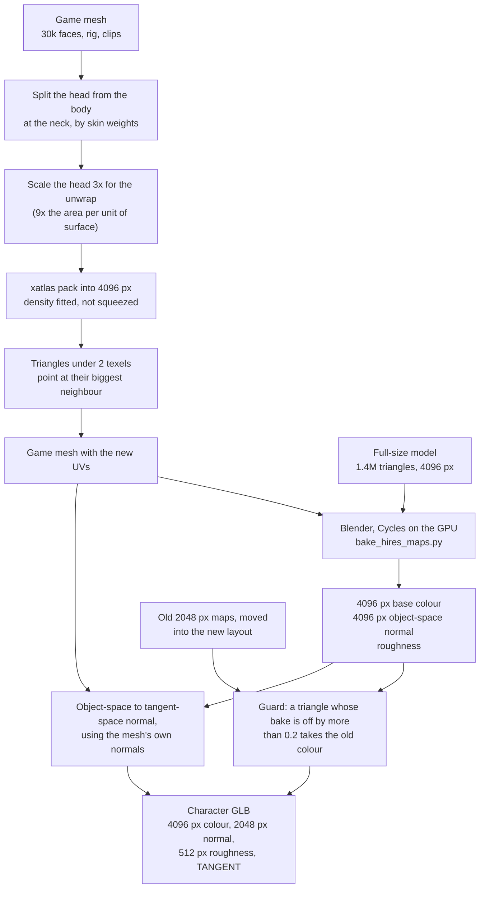

1. **Dense head.** The head triangles (two or more corners owned mostly by a `Head` joint) get
   their own copies of their vertices, scaled up 3x about the head's centre, and xatlas packs that
   as a separate, larger surface. The mesh itself is untouched. The seam falls at the neck, where
   skin meets skin. A head texel now covers a ninth of the surface a body texel does. The head of a
   biped is 5 to 7% of its surface and takes 12 to 17% of the atlas. The wolf's head is 30% of its
   surface and takes 24%.
2. **Fit, do not squeeze.** Given only a resolution, xatlas estimates its texel density and
   overshoots: 5300 px for a 4096 px target. Shrinking the UVs afterwards also shrinks the padding.
   Giving it both a density and a resolution is worse, because it squeezes the charts into the
   resolution and overlaps them, which put robe colours into the hair. `pack()` measures the density
   from a first pass and repeats at one that fits, with no resolution.
3. **Tiny triangles.** Roughly 2,000 to 3,000 triangles per character cover under two texels and
   would be painted with whatever the margin pulled in from the island beside them. They get their
   own vertices and are pointed at the middle of their largest neighbour, so a sliver looks like
   what it is part of.
4. **Bake in Blender.** `tools/bake_hires_maps.py` imports the game mesh and the full model and
   casts rays from the game surface to the full one on the GPU (Cycles, OptiX), once for the diffuse
   colour, once for the normal and once for the roughness. It takes about a minute.
5. **Guard.** The full model has strands, hairpins and inner layers under or in front of the game
   mesh, and a ray can land on one of them. A triangle whose average baked colour is more than 0.2
   from the old export's, moved into the same layout, takes the old colour. Real detail such as a
   pupil moves a triangle's average very little. 0.3 to 3.8% of triangles are replaced.
6. **Normals in the engine's frame.** Blender's own tangent space follows its automatic vertex
   normals, which are not the normals stored in the GLB, and the mismatch showed as pale and dark
   polygons shaped like the texture islands. The bake is made in object space instead and converted
   to tangent space in `tangent_space_normals()`, against the GLB's own normals and a `TANGENT`
   attribute that `vertex_tangents()` writes into the file. Godot uses an explicit tangent as it
   finds it, so the map is lit the way it was made. `fix_character_rig.py` turns the tangents with
   the same skinning it applies to the normals.

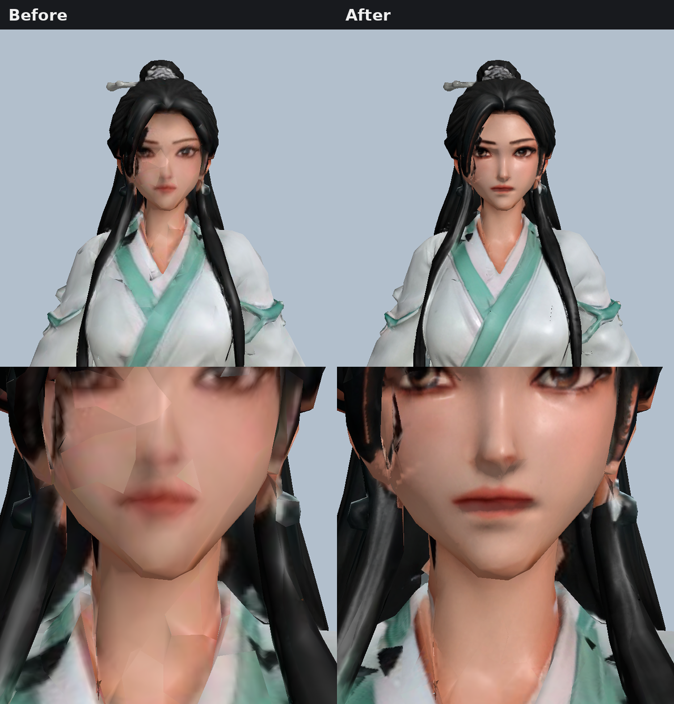

Left: the 2048 px export. Right: baked from the full model. Top row: a bust. Bottom row: the face
from 45 cm, closer than the game's camera can go. The lashes, lips, nostrils and the shape of the
nose now come from the 1.4M-triangle mesh's own normal map.

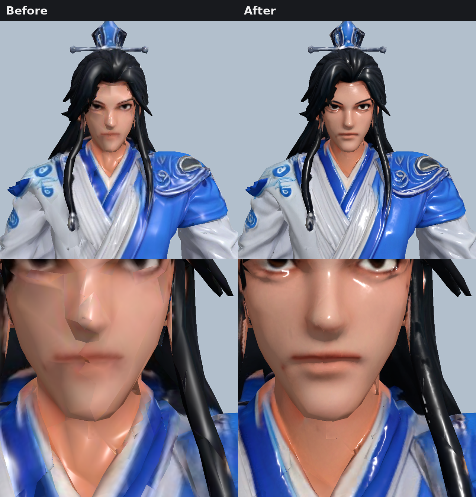

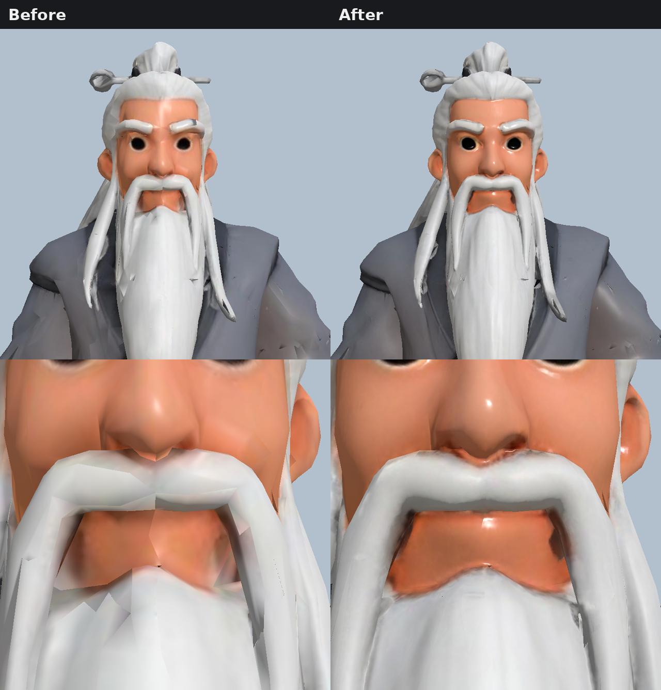

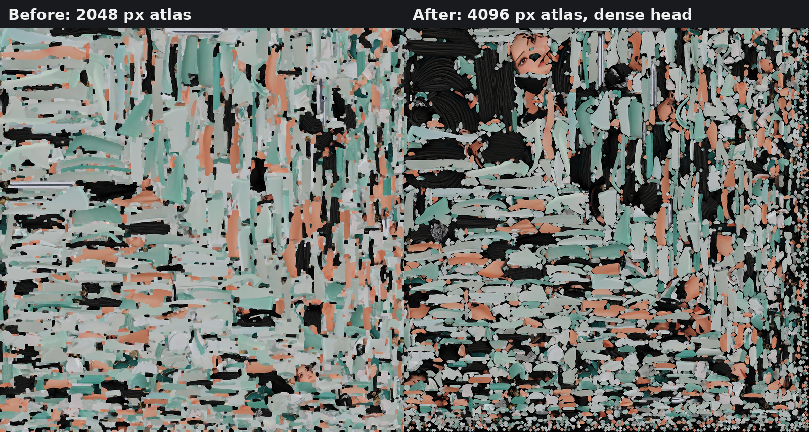

The old atlas gives the whole body one density. The new one gives the head a large share. Small
islands packed along the right edge are the tiny triangles of step 3.

### Measured result

Texels per centimetre on a 1.8 m character, over the triangles that follow the head joint, from the
GLBs themselves:

| Model | Albedo | Head texels per cm, before | After | Gain (linear) | Body texels per cm, before | After |
| --- | --- | --- | --- | --- | --- | --- |
| `female_cultivator` | 2048 to 4096 px | 5.8 | 27.4 | 4.7x | 5.8 | 9.2 |
| `hero` | 2048 to 4096 px | 6.1 | 28.5 | 4.7x | 6.2 | 9.7 |
| `elder` | 2048 to 4096 px | 6.4 | 28.9 | 4.6x | 6.5 | 9.9 |
| `demon_wolf` | 2048 to 4096 px | 4.3 | 12.3 | 2.8x | 4.3 | 4.1 |

The source model's own face is about 27 texels per cm, so the head now holds all the detail Tripo
made. Baking the head at a higher density would only enlarge the same pixels. The wolf's head is a
quarter of its surface, so it gets a smaller share per texel.

`tests/run_tests.gd` checks that every character has a 4096 px albedo, a normal map and a head at
least 4x as dense as its body (8.5x to 8.9x now). The albedo and density checks fail on the
previous models, which had 2048 px albedos and the same density everywhere.

### What it costs

| Map | Before | After |
| --- | --- | --- |
| Base colour | 2048 px JPEG | 4096 px JPEG, quality 92 |
| Normal | 1024 px PNG, blurred 2 px | 2048 px JPEG, quality 95, blurred 0.6 px |
| Metal and roughness | 1024 px PNG | 512 px PNG, roughness only |

The characters grow from 5.5 to 6.1 MB to 9.0 to 10.4 MB each. Godot compresses the textures when
it imports them. The roughness is only a factor over a smooth map and the metallic channel is zero,
so 512 px loses nothing.

```bash
pip install xatlas numpy pillow scipy
blender --version                       # Blender 5.2 was used; Cycles on a GPU takes about a minute
tools/repair_character.sh female_cultivator
# or by hand:
tools/rebake_textures.py .tripo-work/female_cultivator/optimised/.../model.glb \
    /tmp/rebaked.glb .tripo-work/female_cultivator/anim/.../model.glb
```

If another `python3.x` comes before the system one on `PATH` (uv and pyenv do this), Blender fails
to start with `No module named 'math'`: its embedded Python finds its standard library through
`PATH`. `rebake_textures.py` puts Blender's own directory first for that reason.

### Limits

- The seam at the neck is a texture seam. Both sides are baked from the same source, so the colour
  matches, but the pixels are not shared.
- The guard trades sharpness for safety on 0.3 to 3.8% of triangles, which are soft instead of
  wrong. Where the full model has a loose strand across a face, that triangle keeps the old,
  blurrier colour.
- A dark vertical line runs down the face in the valley's light. It stays with the normal map off,
  with shadows off and with the sun hidden, it moves across the face when the cultivator turns, and
  a plain sphere in the same spot shows it too. It comes from the sky's ambient light and not from
  the model. It was seen with Mesa's software renderers (llvmpipe, lavapipe) and not checked on a
  GPU.
- The Compatibility renderer drops the tangents of skinned meshes, which made the faces patchy
  there. The game's cel shader does not read normal maps at all; see
  [Normal maps on the Compatibility renderer](architecture.md#normal-maps-on-the-compatibility-renderer).
- Props still use the 2048 px export. The sect hall, spirit tree and jade rock are seen from a
  distance, and the same bake would work if they were ever seen close up.

## Material tuning

In the game the models are drawn with an anime cel shader that keeps only the albedo (see
[Anime cel shading](architecture.md#anime-cel-shading)), so the factors below matter only where the
GLB is viewed as it is, in Blender or a glTF viewer.

Tripo's metal/roughness map is almost fully rough. Its green channel (roughness) averages 0.91, and
its blue channel (metallic) is noisy, averaging 0.13 with peaks in cloth and hair. Lit by the sun,
the characters look like matte clay with dark metallic specks. glTF multiplies each factor by its
map channel, so `tools/tune_character_materials.py` sets the factors and leaves the maps alone:

```bash
tools/tune_character_materials.py assets/models/hero.glb assets/models/hero.glb   # roughness 0.55, metallic 0
```

Effective roughness becomes 0.55 times the map, about 0.5, and metallic becomes 0. The four
characters were tuned this way. Props and the hall keep their Tripo factors.

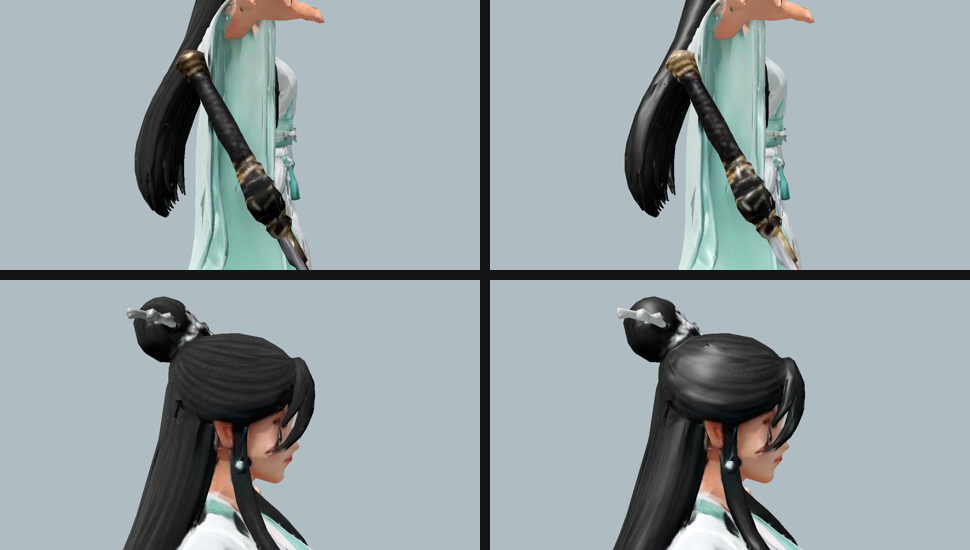

Left: Tripo's factors. Right: roughness 0.55 and metallic 0. Hair and the robe catch light and read
as cloth.

## Rig repair

The first version of the game played Tripo's rigs and preset clips as they came. In the game the
characters walked sideways or backwards, their textures smeared and tore as they moved, and none of
the clips fitted: the idle ran 15 s, the hurt 14 s and the slash 6.5 s. Blender and a CPU skinning
check of the GLBs showed four separate faults in the files themselves, not in the game code.

| Fault | What it looked like | Cause in the GLB |
| --- | --- | --- |
| Facing | Characters walked sideways, wolves walked backwards | Humanoids face +X and the wolf faces +Z, while the game assumed one front for all of them |
| Pinned vertices | Long shards trailing behind a moving body | 77 to 115 vertices per character are bound 100% to `neutral_bone`, a dummy joint that never moves |
| Bridged cloth | Skirts, sleeves and hair stretched into spikes and smeared the texture | Cloth that touches another limb in the T-pose is bound to both limbs, so the triangles between them are pulled apart |
| Preset clips | Long, odd, full-body routines (a seated "hurt") | Tripo's presets are 15 s idles, 14 s hurts and 6.5 s slashes, and each is a different routine |


Top row: Tripo's `walk` as imported, in profile and torn by its skin weights. Bottom row: the repaired
`run`, facing the camera.

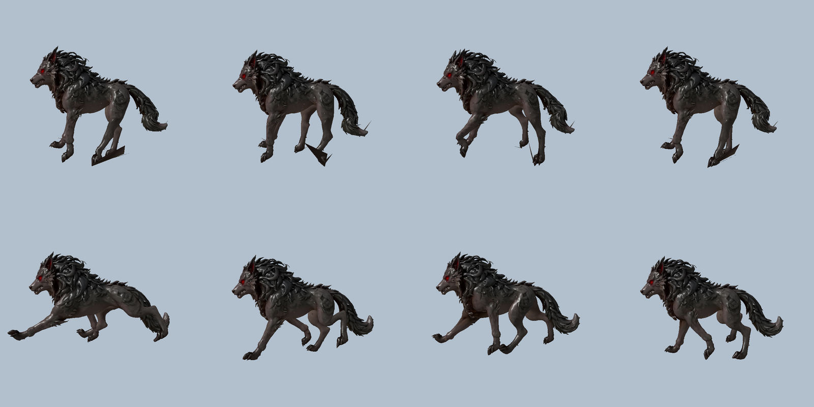

Top row: Tripo's wolf walk, with shards under the paws. Bottom row: the repaired run.

`tools/fix_character_rig.py` repairs a character GLB in five steps. It edits the glTF JSON and the
vertex buffers directly, so the textures, UVs and material are copied through byte for byte.

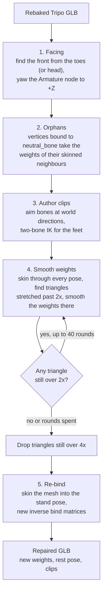

1. **Facing.** The front is found from the toe bones, or from the head and tail of the wolf, and
   snapped to an axis. The `Armature` node gets a yaw so every character faces +Z, the glTF front,
   and `ModelUtils.FORWARD_OFFSET` is now `0`. The nodes are turned, not the vertices.
2. **Orphans.** Each vertex pinned to `neutral_bone` takes the weights of its nearest skinned
   neighbours over the mesh, so it moves with the body it belongs to.
3. **Clips.** Tripo's bind poses are not clean: the knees are bent, one foot is ahead of the other
   and every bone has its own local axes, so fixed joint angles would bend each model differently.
   `rig_poser.Poser` aims each bone's own Y axis at a world direction instead, and solves the legs
   with two-bone IK so the feet stay planted. The clips are in `rig_clips.py`.
4. **Weights.** The mesh is skinned through every pose of every clip. Any triangle whose edge grows
   past 2x its bind length gets its weights blended with its neighbours, and the check repeats.
   What is still past 4x afterwards is dropped from the index buffer: 14 to 236 triangles of about
   37,000 per character. No holes show in the renders.
5. **Bind pose.** The mesh is skinned into the relaxed stand pose once and bound there, so each clip
   is a small move away from the bind pose instead of a swing from a T-pose. Arms that hang from a
   T-pose are the hardest thing for skinning, so this removes the largest single source of stretch.

```bash
pip install numpy scipy
tools/fix_character_rig.py assets/models/hero.glb /tmp/hero.glb              # biped
tools/fix_character_rig.py assets/models/demon_wolf.glb /tmp/wolf.glb --kind quadruped
```

It takes about a minute per character. The GLB is marked once repaired, and `--force` overrides
that.

### Measured result

The CI test (`tests/run_tests.gd`) skins every character on the CPU in the same way and measures
the largest ratio of a posed triangle edge to its bind length. Same method, six poses of every clip,
on the Tripo models before the repair and the repaired ones now:

| Model | Triangles over 5x in the worst pose, before | After | Worst edge, before | After | Longest clip, before | After |
| --- | --- | --- | --- | --- | --- | --- |
| `female_cultivator` | 471 (1.25%) | 0 | 248x | 5x | 15.4 s | 3.2 s |
| `hero` | 515 (1.41%) | 0 | 246x | 4x | 15.4 s | 3.2 s |
| `elder` | 517 (1.41%) | 0 | 243x | 5x | 15.4 s | 3.2 s |
| `demon_wolf` | 1363 (3.57%) | 0 | 213x | 4x | 2.6 s | 2.4 s |

### Clips

All clips are in the model's own units, about 1 unit tall, and the game scales a model to 1.8 m. Every
loop starts and ends on the same pose, and every pose is built around the stand pose, so the clips
blend into each other.

| Clip | Biped length | Wolf length | What it is |
| --- | --- | --- | --- |
| `idle` | 3.2 s | 2.4 s | Breathing, weight shift, head turn. The wolf also sways its tail |
| `walk` | 1.0 s | 0.9 s | An IK walk with the feet planted. The wolf trots on diagonal pairs of legs |
| `run` | 0.56 s | 0.5 s | Matches the game's 5.5 m/s (the clip covers about 5.4 m/s), with a forward lean. The wolf bounds |
| `slash` | 0.6 s | 0.55 s | A right-handed diagonal cut, with the blade landing at 0.27 s. The wolf bites |
| `hurt` | 0.5 s | 0.45 s | A short recoil that settles |
| `greet` | 1.8 s | none | A fist-and-palm salute with a bow |

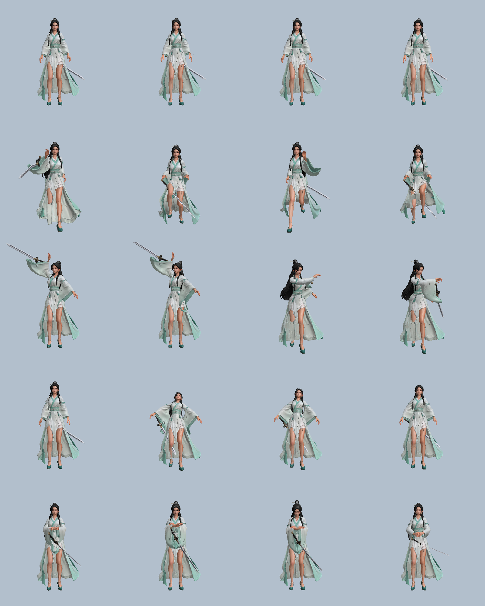

Rows: idle, run, slash, hurt, greet.

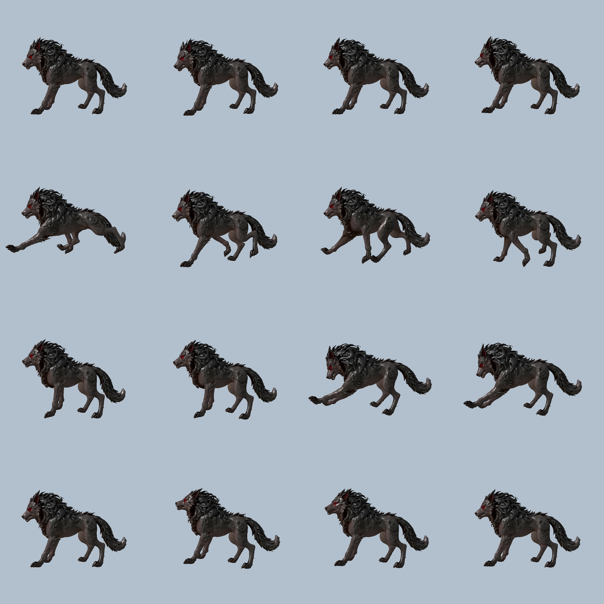

Rows: idle, run, slash (the bite), hurt.

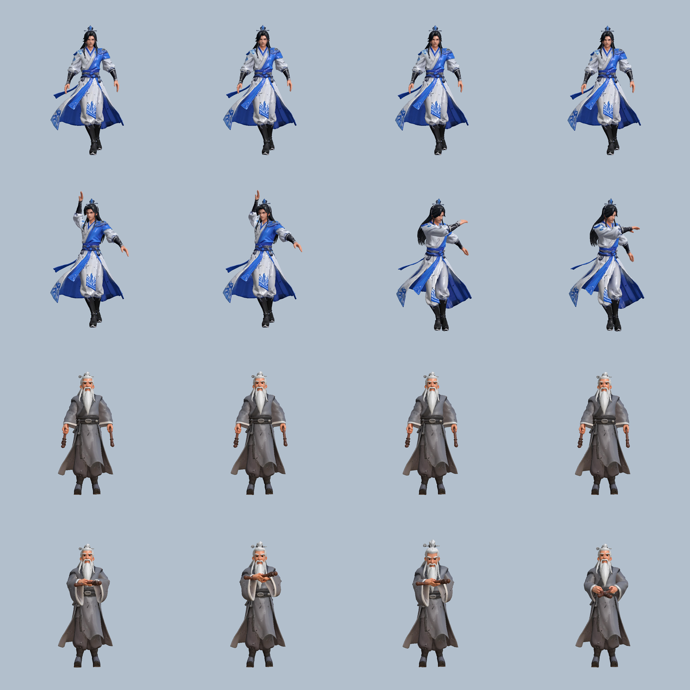

Rows: Lin's idle and slash, Elder Wen's idle and greet.

The contact sheets come from `tools/capture_clip_sheet.gd`, which can also load an old GLB from a
path, so a before and after sit in the same sheet:

```bash
godot --path . --script res://tools/capture_clip_sheet.gd -- sheet.png front \
    "/tmp/old/hero.glb|walk|0.2,0.7,1.2,1.7" "res://assets/models/hero.glb|run|0.0,0.14,0.28,0.42"
```

## Rigging

- Biped characters are rigged with the v1.0 rig (`-p model=rig-v1.0`), the wolf with the default
  v2.0 quadruped rig. Tripo's preset clips are still requested, because the retarget step is what
  produces the animated GLB, but `fix_character_rig.py` replaces them.
- Tripo's quadruped v2.0 rig names its bones by chain (`0_Left_Limb_3`), not by role, and the names
  do not match the legs. `rig_clips.py` maps the four legs, the spine, the head and the tail by
  their position.
- Each retarget call accepts at most five animations, and the CLI bills per animation.

## Assets

| Asset | In game | Prompt (abridged) | Tripo tasks | Credits |
| --- | --- | --- | --- | --- |
| `female_cultivator` | Player cultivator | xianxia female cultivator heroine, silver hairpin, pale jade robes, sword, T-pose | gen `444c69bb`, rig v1 `2493af58`, anim `e2c84f77` (idle, walk, run, slash, hurt), convert `33497c9d` | 30 + 25 + 50 + 10 |
| `hero` | Sect disciple Lin, NPC | cultivator in white and blue robes, sword, T-pose | gen `00bae8d2`, rig v1 `6c3b1aa4`, anim `8fde6909` (idle, walk, slash, hurt), convert `c6f3803d` | 30 + 25 + 40 + 10 |
| `elder` | Elder Wen, quest giver | old Taoist master, long white beard, staff, T-pose | gen `1d8e57ed`, rig v1 `87888fad`, anim `1b1b0663` (idle, walk, greet), convert `d472aa1d` | 20 + 25 + 30 + 10 |
| `demon_wolf` | Spirit beast enemy | demonic spirit wolf, red eyes, black qi aura | gen `a115f644`, rig v2 quadruped `2f2c99d6`, anim `eb0d61ed` (walk), convert `7c180481` | 20 + 25 + 10 + 10 |
| `sect_hall` | Scenery, walk-in (18 m tall) | sect temple hall, curved tile roof, red pillars | gen `b79bd7b5`, convert `c7c2c3ef` | 20 + 10 |
| `spirit_tree` | Scenery | ancient spirit peach tree, pink blossoms | gen `757f9ef2`, convert `e71edc2f` | 20 + 10 |
| `jade_rock` | Scenery, solid, glowing | glowing jade spirit stone emitting qi | gen `7bfb9e5e`, convert `98751661` | 20 + 10 |

The clip lists in the character rows are the presets requested from Tripo. `fix_character_rig.py`
replaces them with the clips described under [Rig repair](#rig-repair).

The first hero was exported as FBX with the `game-pc` preset (task `0655aeaa`, 5 credits). That
export was discarded in favour of GLB, so its cost is not included in the table. The 1024 px
versions of the static props were replaced by the 2048 px exports above, which cost 10 credits each.
Re-exporting the static props doubled every texture: the old maps were 256, 1024 and 512 px, and the
new ones are 512, 2048 and 1024 px.

## Previews

Tripo's own renders of each generated mesh:

| | | |
| --- | --- | --- |
| 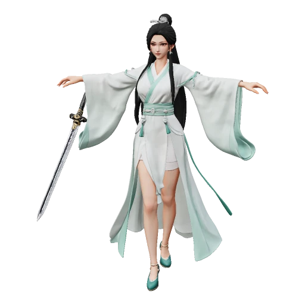 |  | 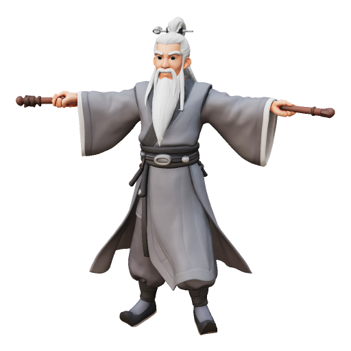 |
| female_cultivator | hero | elder |
| 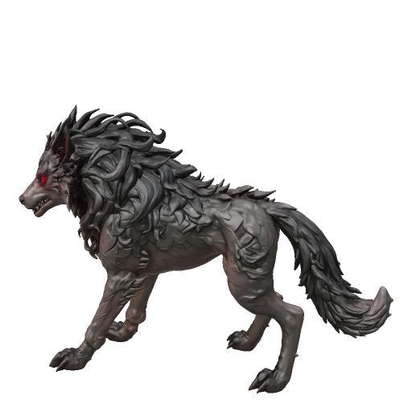 | 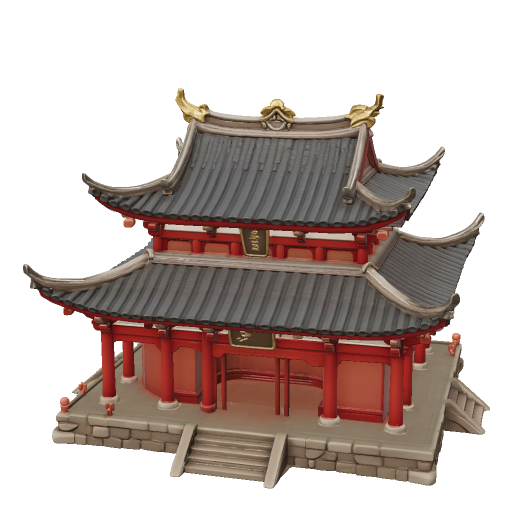 | 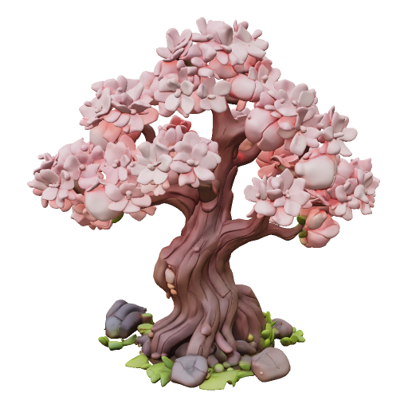 |
| demon_wolf | sect_hall | spirit_tree |
| 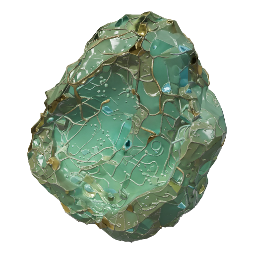 | | |
| jade_rock | | |

## Using the models in Godot

- `ModelUtils.fit_to_height` scales each model to a target height in metres, so the source
  scale from Tripo does not matter.
- Solid props get a box collider built from the same measured bounds.
- The sect hall is fitted to 18 m, twice the height of the other scenery. Its collision is built
  from the model's own triangles, minus the stairs, so the walls, pillars and terraces block the
  player where they are drawn. Each flight of stairs is replaced by a ramp, and a stone ramp drops
  from the east entry gallery into the cella. `main.gd` builds these in `_add_hall`, and the
  headless tests check the east doorway, the cella wall, the entry ramp and the front terrace.
- `tools/carve_hall_doorway.py` opens the east wall of the cella in the GLB itself. The carve is in
  the model rather than in code, so the visible wall and its collision disappear together. The
  constants at the top of `main.gd` were measured from the carved model at 18 m, so re-export the
  hall with the same fit height or measure the new one.
- Every character faces +Z after the rig repair, so `ModelUtils.FORWARD_OFFSET` is `0`. A model
  that comes out of Tripo facing another way is turned by `fix_character_rig.py`, not in code.
  Prop and scenery models are not repaired and are never turned by the game.
- `CharacterAnimator` looks up clips by name, ignoring any prefix. A clip named `preset:biped:walk`
  or `Armature|walk` both match `walk`, and a model without a run clip walks instead.
- Textures are embedded in each GLB. The import setting `gltf/embedded_image_handling=2` keeps
  them inside the imported scene, so Godot does not extract texture files next to the models. An
  extracted texture that is deleted leaves a stale UID in the import cache, which produces the
  `invalid UID` warnings this setting avoids.
