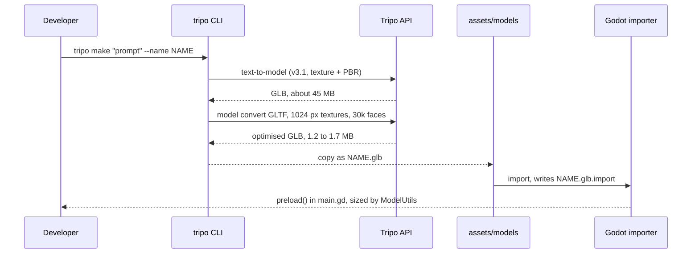

# Tripo asset pipeline

Every 3D model in `assets/models/` was generated with the Tripo CLI from a text prompt. The
full-size GLBs that Tripo returns are about 45 MB each because of their 4K-class textures, so
each one is re-exported with 1024 px textures and at most 30,000 faces before it is committed.

## Flow



## Regenerating

`tools/generate_assets.sh` holds the exact prompts and commands. It needs the CLI and a logged-in
account:

```bash
npm install -g tripo-cli
tripo login
tools/generate_assets.sh          # every asset
tools/generate_assets.sh elder    # one asset
DRY_RUN=1 tools/generate_assets.sh  # validate prompts, spends no credits
```

A text-to-model run costs about 20 credits and an optimised convert about 10. Those numbers are
from the runs that produced the committed models.

## Assets

| Asset | In game | Prompt (abridged) | Tripo tasks | Credits |
| --- | --- | --- | --- | --- |
| `hero` | Player cultivator | cultivator in white and blue robes, sword, T-pose | `00bae8d2` generate, `a1fbdd1a` convert | 30 + 10 |
| `elder` | Elder Wen, quest giver | old Taoist master, long white beard, staff, T-pose | `1d8e57ed` generate, `87cae3bb` convert | 20 + 10 |
| `demon_wolf` | Spirit beast enemy | demonic spirit wolf, red eyes, black qi aura | `a115f644` generate, `4a5757c1` convert | 20 + 10 |
| `sect_hall` | Scenery, solid | sect temple hall, curved tile roof, red pillars | `b79bd7b5` generate, `5a81aa1b` convert | 20 + 10 |
| `spirit_tree` | Scenery | ancient spirit peach tree, pink blossoms | `757f9ef2` generate, `3520c981` convert | 20 + 10 |
| `jade_rock` | Scenery, solid, glowing | glowing jade spirit stone emitting qi | `7bfb9e5e` generate, `9b58a941` convert | 20 + 10 |

The hero was first exported as FBX with the `game-pc` preset (task `0655aeaa`, 5 credits). That
export was discarded in favour of GLB, so its cost is not included in the table.

## Previews

Tripo's own renders of each generated mesh:

| | | |
| --- | --- | --- |
|  |  |  |
| hero | elder | demon_wolf |
|  |  |  |
| sect_hall | spirit_tree | jade_rock |

## Using the models in Godot

- `ModelUtils.fit_to_height` scales each model to a target height in metres, so the source
  scale from Tripo does not matter.
- Solid props get a box collider built from the same measured bounds.
- Each model's front is aligned with `ModelUtils.FORWARD_OFFSET`. Change that constant if a
  new model faces the wrong way.
