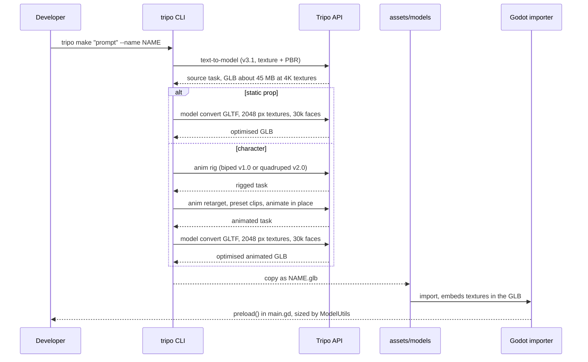
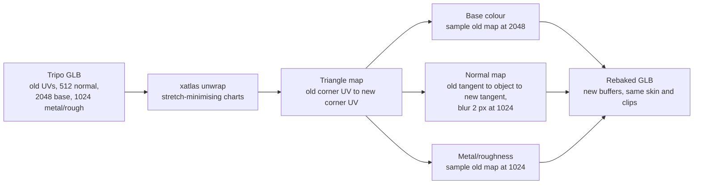

# Tripo asset pipeline

Every 3D model in `assets/models/` was generated with the Tripo CLI from a text prompt. The
full-size GLBs that Tripo returns are about 45 MB each because of their 4K-class textures, so
each one is re-exported with 2048 px textures and at most 30,000 faces before it is committed.
The characters are also rigged and given preset animations.

## Flow



## Regenerating

`tools/generate_assets.sh` holds the exact prompts, rig types, animation presets and commands. It
needs the CLI and a logged-in account:

```bash
npm install -g tripo-cli
tripo login
tools/generate_assets.sh                 # every asset
tools/generate_assets.sh female_cultivator   # one asset
DRY_RUN=1 tools/generate_assets.sh       # validate prompts, spends no credits
```

Approximate credit costs from the runs that produced the committed models:

| Step | Credits |
| --- | --- |
| Text-to-model, standard texture | 20 |
| Text-to-model, `texture_quality=detailed` | 30 |
| Convert to GLTF at 2048 px | 10 |
| Rig (`anim rig`) | 25 |
| Each preset animation (`anim retarget`) | 10 |

## UV re-unwrap and texture transfer

Tripo's own unwrap splits clothing and skin into hundreds of small, stretched islands. About 15%
of triangles are stretched more than 3:1, and the 512 px normal map shows up as grain when the
camera gets close. `tools/rebake_textures.py` fixes this for each model:

1. Unwraps the mesh with xatlas, which minimises stretch and pads charts by 4 px.
2. Transfers the base colour, normal and metal/roughness maps from the old UVs to the new ones.
   Each triangle keeps its index, so the old UV of any new texel is the barycentric blend of that
   triangle's old corner UVs.
3. Converts normals through the old and new tangent frames, then blurs them with a 2 px radius at
   1024 px. The blur removes the baked grain and keeps the broad folds.
4. Writes the GLB with new vertex buffers and images. Skins, animations and the material are
   carried over unchanged.



```bash
pip install xatlas numpy pillow
tools/rebake_textures.py assets/models/hero.glb .tripo-work/hero.glb
```

Measured on the hero model (the other characters and props show the same pattern):

| Metric | Tripo UV | Rebaked |
| --- | --- | --- |
| Triangles stretched more than 3:1 | 14.2% | 1.3% |
| 90th percentile stretch | 3.75 | 1.18 |
| Texel density, 5th to 95th percentile (relative to median) | 0.60 to 1.64 | 0.95 to 1.17 |
| Normal map | 512 px | 1024 px, blurred |

The rebaked GLBs are 1.4 to 1.6 times the size of the Tripo originals, 36 MB in total instead of
24 MB. Around 1,000 tiny triangles per
character snap to a single texel during packing. They are too small to see, but they are a known
limitation.


Before (top) is each model's Tripo UV layout. After (bottom) is the re-unwrapped layout with the
transferred textures. Each pair is the same camera position.

## Material tuning

Tripo's metal/roughness map is almost fully rough. Its green channel (roughness) averages 0.91, and
its blue channel (metallic) is noisy, averaging 0.13 with peaks in cloth and hair. Lit by the sun,
the characters look like matte clay with dark metallic specks. glTF multiplies each factor by its
map channel, so `tools/tune_character_materials.py` sets the factors and leaves the maps alone:

```bash
tools/tune_character_materials.py assets/models/hero.glb assets/models/hero.glb   # roughness 0.55, metallic 0
```

Effective roughness becomes 0.55 times the map, about 0.5, and metallic becomes 0. The four
characters were tuned this way. Props and the hall keep their Tripo factors.


Left: Tripo's factors. Right: roughness 0.55 and metallic 0. Hair and the robe catch light and read
as cloth.

## Rigging and animation

- Biped characters are rigged with the v1.0 rig (`-p model=rig-v1.0`). Its `preset:biped:*`
  clips are the ones the game uses: `idle`, `walk`, `run`, `slash`, `hurt` and `greet_01`.
- The wolf is quadruped and uses the default v2.0 rig. Its only usable preset here is
  `preset:quadruped:walk`. The v2.0 `idle`, `run`, `slash` and `hurt` presets were rejected for
  quadruped rigs, so the game freezes the walk cycle while the wolf is idle and flinches or lunges
  procedurally.
- Animations are baked in place (`--animate-in-place`), because the game drives movement.
- Each retarget call accepts at most five animations, and the CLI bills per animation.

## Assets

| Asset | In game | Prompt (abridged) | Tripo tasks | Credits |
| --- | --- | --- | --- | --- |
| `female_cultivator` | Player cultivator | xianxia female cultivator heroine, silver hairpin, pale jade robes, sword, T-pose | gen `444c69bb`, rig v1 `2493af58`, anim `e2c84f77` (idle, walk, run, slash, hurt), convert `33497c9d` | 30 + 25 + 50 + 10 |
| `hero` | Sect disciple Lin, NPC | cultivator in white and blue robes, sword, T-pose | gen `00bae8d2`, rig v1 `6c3b1aa4`, anim `8fde6909` (idle, walk, slash, hurt), convert `c6f3803d` | 30 + 25 + 40 + 10 |
| `elder` | Elder Wen, quest giver | old Taoist master, long white beard, staff, T-pose | gen `1d8e57ed`, rig v1 `87888fad`, anim `1b1b0663` (idle, walk, greet), convert `d472aa1d` | 20 + 25 + 30 + 10 |
| `demon_wolf` | Spirit beast enemy | demonic spirit wolf, red eyes, black qi aura | gen `a115f644`, rig v2 quadruped `2f2c99d6`, anim `eb0d61ed` (walk), convert `7c180481` | 20 + 25 + 10 + 10 |
| `sect_hall` | Scenery, walk-in (18 m tall) | sect temple hall, curved tile roof, red pillars | gen `b79bd7b5`, convert `c7c2c3ef` | 20 + 10 |
| `spirit_tree` | Scenery | ancient spirit peach tree, pink blossoms | gen `757f9ef2`, convert `e71edc2f` | 20 + 10 |
| `jade_rock` | Scenery, solid, glowing | glowing jade spirit stone emitting qi | gen `7bfb9e5e`, convert `98751661` | 20 + 10 |

The first hero was exported as FBX with the `game-pc` preset (task `0655aeaa`, 5 credits). That
export was discarded in favour of GLB, so its cost is not included in the table. The 1024 px
versions of the static props were replaced by the 2048 px exports above, which cost 10 credits each.
Re-exporting the static props doubled every texture: the old maps were 256, 1024 and 512 px, and the
new ones are 512, 2048 and 1024 px.

## Previews

Tripo's own renders of each generated mesh:

| | | |
| --- | --- | --- |
|  |  |  |
| female_cultivator | hero | elder |
|  |  |  |
| demon_wolf | sect_hall | spirit_tree |
|  | | |
| jade_rock | | |

## Using the models in Godot

- `ModelUtils.fit_to_height` scales each model to a target height in metres, so the source
  scale from Tripo does not matter.
- Solid props get a box collider built from the same measured bounds.
- The sect hall is fitted to 18 m, twice the height of the other scenery. Its collision is built
  from the model's own triangles, minus the stairs, so the walls, pillars and terraces block the
  player where they are drawn. Each flight of stairs is replaced by a ramp, and a stone ramp drops
  from the east entry gallery into the cella. `main.gd` builds these in `_add_hall`, and the
  headless tests check the east doorway, the cella wall, the entry ramp and the front terrace.
- `tools/carve_hall_doorway.py` opens the east wall of the cella in the GLB itself. The carve is in
  the model rather than in code, so the visible wall and its collision disappear together. The
  constants at the top of `main.gd` were measured from the carved model at 18 m, so re-export the
  hall with the same fit height or measure the new one.
- Each model's front is aligned with `ModelUtils.FORWARD_OFFSET`. Change that constant if a
  new model faces the wrong way.
- `CharacterAnimator` looks up clips by name, ignoring any prefix. A clip named `preset:biped:walk`
  or `Armature|walk` both match `walk`.
- Textures are embedded in each GLB. The import setting `gltf/embedded_image_handling=2` keeps
  them inside the imported scene, so Godot does not extract texture files next to the models. An
  extracted texture that is deleted leaves a stale UID in the import cache, which produces the
  `invalid UID` warnings this setting avoids.
